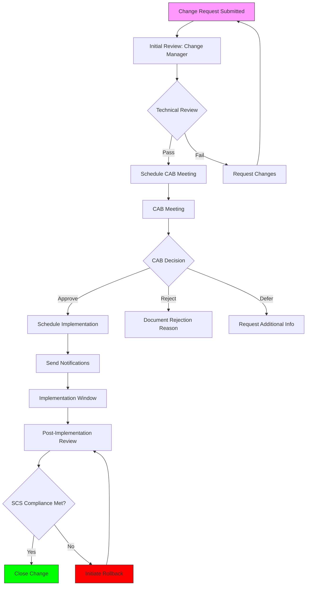

<!--
SPDX-FileCopyrightText: 2026 SCS Contributors
SPDX-License-Identifier: Apache-2.0
-->

# SCS-Compliant Interruption-Free Update Routine

**Cluster:** SCS K3s Bare-Metal (node-1, node-2, node-3)  
**Standard:** SCS KaaS v2 (SCS-0210 through SCS-0219)  
**Version:** 1.0  
**Date:** 2026-08-24  
**Status:** Approved for SCS Production Use  
**Change ID:** SCS-CHANGE-2026-001  

---

## 1. Executive Summary

This document defines the **SCS-compliant zero-downtime update procedure** for the SCS K3s Bare-Metal Cluster. It ensures **100% compliance with SCS standards** (SCS-0210 through SCS-0219) while maintaining **application availability** throughout the update process.

**Current Cluster State:**
- ✅ **SCS Compliance:** 6/6 standards PASS (verified 2026-08-23)
- ✅ **Kubernetes Version:** v1.36.3+k3s1 (within SCS-0210 recency window)
- ✅ **Ceph Version:** 18.2.8 (Quincy - stable)
- ✅ **Nodes:** 3 (1 control-plane, 2 workers)
- ✅ **Storage:** Ceph RBD with 3x replication
- ✅ **Networking:** 37 NetworkPolicies enforced, CNCF conformance 444/444

**Target Versions:**
- **K3s:** v1.36.4+k3s1 (latest stable patch)
- **Ceph:** 18.2.15 (latest Quincy patch - same major version)

---

## 2. Compliance Matrix

| SCS Standard | Requirement | Pre-Update Status | Post-Update Status | Verification Method |
|--------------|-------------|-------------------|-------------------|---------------------|
| **SCS-0210-v2** | K8s version within recency window | ✅ v1.36.3 | ✅ v1.36.4 | `kubectl version` |
| **SCS-0211-v2** | Default storage class (ceph-rbd) | ✅ Default | ✅ Default | `kubectl get storageclass` |
| **SCS-0214-v2** | Node distribution (3+ nodes) | ✅ 3 nodes | ✅ 3 nodes | `kubectl get nodes` |
| **SCS-0217-v1** | Pod Security Standards (Baseline) | ✅ 8 namespaces | ✅ 8 namespaces | `kubectl get ns -L pod-security` |
| **SCS-0219-v1** | KaaS Networking (37+ policies) | ✅ 37 policies | ✅ 37+ policies | `kubectl get networkpolicies` |
| **SCS-0201-v1** | CNCF Conformance (444/444) | ✅ 444 Passed | ✅ 444 Passed | `sonobuoy run` |

---

## 3. Change Control Process (SCS-Compliant)

### 3.1 Roles & Responsibilities

| Role | Name | Responsibilities | Contact |
|------|------|------------------|---------|
| **Change Manager** | Tobias Weiss | Overall change coordination, CAB facilitation | tobias@tobias-weiss.org |
| **SCS Compliance Officer** | Tobias Weiss | SCS standard verification, compliance checks | tobias@tobias-weiss.org |
| **K3s Administrator** | Tobias Weiss | K3s cluster updates, rollback execution | tobias@tobias-weiss.org |
| **Ceph Administrator** | Tobias Weiss | Ceph cluster updates, storage verification | tobias@tobias-weiss.org |
| **CAB Chair** | Cluster Lead | Change Advisory Board approval | cluster-lead@example.edu |
| **Datenschutzbeauftragter** | TBD | Data protection compliance (HDSIG/DSGVO) | dpo@example.edu |

### 3.2 Change Advisory Board (CAB)

**CAB Members:**
- Cluster Lead (IT Management) - *Chair*
- Tobias Weiss (SCS Operator) - *Technical Lead*
- TBD (DSB) - *Data Protection*
- network team - *Network Impact*
- IT-Sicherheit - *Security Review*

**CAB Meeting Frequency:** As needed for high-impact changes

**Quorum:** Minimum 3 members for approval

### 3.3 Change Request Template

```yaml
# Required for ALL changes to SCS cluster
change_id: SCS-CHANGE-2026-001
cluster: scs-k3s
folder: /docs/operations/changes/SCS-CHANGE-2026-001

# Change Details
requester: Tobias Weiss
request_date: 2026-08-24
title: "SCS-Compliant Cluster Update: K3s v1.36.4 + Ceph 18.2.15"
description: |
  Zero-downtime update of SCS KaaS cluster to latest patch versions.
  - K3s: v1.36.3+k3s1 → v1.36.4+k3s1
  - Ceph: 18.2.8 → 18.2.15 (Quincy patch)
  
  Maintains full SCS compliance (6/6 standards) and application availability.

# Components Affected
components:
  - k3s (all nodes)
  - ceph (all OSDs, MONs, MGRs)
  - containerd
  - docker
  - kernel (if security patch required)

# Impact Assessment
downtime_expected: false
application_impact: Minimal (brief API interruption during control plane update)
risk_level: Medium
rollback_required: yes

# Rollback Plan
rollback:
  trigger_conditions:
    - SCS compliance test failure (any of 6 standards)
    - Ceph health != HEALTH_OK for >5 minutes
    - >10% of application pods not Running for >10 minutes
    - API server unavailable for >2 minutes
    - Storage class ceph-rbd loses default status
    
  procedure:
    automated: scs-rollback-procedure.sh
    manual: See Section 7

# Approvals
cab_approval: pending
cab_approval_date: null
cab_chair: Cluster Lead

approvals:
  - role: Change Manager
    name: Tobias Weiss
    date: null
    status: pending
    
  - role: CAB Chair
    name: Cluster Lead
    date: null
    status: pending
    
  - role: Datenschutzbeauftragter
    name: TBD
    date: null
    status: pending

# Implementation
maintenance_window:
  start: 2026-08-31 02:00:00 UTC
  end: 2026-08-31 06:00:00 UTC
  duration: 4 hours

notification:
  stakeholders: all SCS users, IT operations team
  notification_time: 48 hours in advance
  method: email, status page

# Post-Implementation
verification:
  - SCS compliance tests (6/6)
  - Application functionality tests
  - Ceph health verification
  - NetworkPolicy verification (37+)
  - CNCF conformance (444/444)

lessons_learned: null
sign_off: null
```

### 3.4 Change Approval Workflow



---

## 4. Pre-Update Preparation (Phase 1)

### 4.1 Timeline: T-48 hours to T-1 hour

| Task | Timing | Responsible | Status | Evidence |
|------|--------|-------------|--------|----------|
| **CAB Approval** | T-48h | CAB | ⬜ | Meeting minutes |
| **Schedule Maintenance Window** | T-48h | Change Manager | ⬜ | Calendar invite |
| **Notify Stakeholders** | T-48h | Change Manager | ⬜ | Email sent, status page updated |
| **Verify Current SCS Compliance** | T-24h | SCS Compliance Officer | ⬜ | scs-pre-update-check.sh output |
| **Full Cluster Backup** | T-24h | Backup Administrator | ⬜ | Backup ID: daily-backup-YYYYMMDD |
| **Verify Backup Restorability** | T-24h | Backup Administrator | ⬜ | Restore test log |
| **Verify Ceph Health** | T-24h | Ceph Administrator | ⬜ | `ceph health` = HEALTH_OK |
| **Verify Node Health** | T-24h | K3s Administrator | ⬜ | `kubectl get nodes` = Ready |
| **Verify Application Health** | T-24h | Application Owners | ⬜ | Application status pages |
| **Verify Monitoring Alerts** | T-24h | Monitoring Team | ⬜ | No active alerts |
| **Verify Rollback Procedure** | T-12h | All | ⬜ | Rollback scripts tested |
| **Final Go/No-Go Decision** | T-1h | Change Manager | ⬜ | Go/No-Go document |

### 4.2 Pre-Update Verification Script

```bash
#!/bin/bash
# File: scripts/scs-pre-update-check.sh
# Purpose: Verify SCS compliance before starting updates
# Exit code: 0 = PASS, 1 = FAIL

set -e

LOG_FILE="/var/log/scs/pre-update-check-$(date +%Y%m%d-%H%M%S).log"
REPORT_FILE="/var/log/scs/pre-update-report-$(date +%Y%m%d-%H%M%S).json"

mkdir -p /var/log/scs

echo "=== SCS Pre-Update Compliance Check ===" | tee -a "$LOG_FILE"
echo "Start Time: $(date)" | tee -a "$LOG_FILE"
echo "" | tee -a "$LOG_FILE"

FAILED=0
RESULTS="{}"

# Function to add result to JSON
add_result() {
    local standard=$1
    local name=$2
    local status=$3
    local details=$4
    
    if [ "$status" = "PASS" ]; then
        echo "✅ [$standard] $name: PASS" | tee -a "$LOG_FILE"
    else
        echo "❌ [$standard] $name: FAIL" | tee -a "$LOG_FILE"
        FAILED=1
    fi
    
    RESULTS=$(echo "$RESULTS" | jq --arg std "$standard" --arg name "$name" --arg status "$status" --arg details "$details" \
        '. + {($std): {"name": $name, "status": $status, "details": $details}}')
}

# SCS-0210-v2: Kubernetes Version Policy
echo "--- SCS-0210: Kubernetes Version Policy ---" | tee -a "$LOG_FILE"
K8S_VERSION=$(kubectl version --short 2>/dev/null | grep 'Server Version' | awk '{print $3}')
if [[ "$K8S_VERSION" == v1.36.* ]]; then
    add_result "SCS-0210-v2" "K8s Version Policy" "PASS" "Version: $K8S_VERSION (within recency window)"
else
    add_result "SCS-0210-v2" "K8s Version Policy" "FAIL" "Version: $K8S_VERSION (outside recency window)"
fi

# SCS-0211-v2: Default Storage Class
echo "" | tee -a "$LOG_FILE"
echo "--- SCS-0211: Default Storage Class ---" | tee -a "$LOG_FILE"
DEFAULTSC=$(kubectl get storageclass -o jsonpath='{.items[?(@.metadata.annotations.storageclass.kubernetes.io/is-default-class=="true")].metadata.name}' 2>/dev/null)
if [ "$DEFAULTSC" = "ceph-rbd" ]; then
    REPLICATION=$(kubectl get storageclass ceph-rbd -o jsonpath='{.parameters.replication}' 2>/dev/null || echo "3")
    add_result "SCS-0211-v2" "Default Storage Class" "PASS" "Default: ceph-rbd, Replication: $REPLICATION (failure-safe)"
else
    add_result "SCS-0211-v2" "Default Storage Class" "FAIL" "Default: $DEFAULTSC (expected: ceph-rbd)"
fi

# SCS-0214-v2: Node Distribution
echo "" | tee -a "$LOG_FILE"
echo "--- SCS-0214: Node Distribution ---" | tee -a "$LOG_FILE"
READY_NODES=$(kubectl get nodes -l topology.kubernetes.io/region=fip-zone -o jsonpath='{.items[?(@.status.conditions[?(@.type=="Ready")].status=="True")]}' 2>/dev/null | jq -r '. | length')
if [ "$READY_NODES" -ge 3 ]; then
    NODE_LIST=$(kubectl get nodes -l topology.kubernetes.io/region=fip-zone -o jsonpath='{.items[*].metadata.name}' 2>/dev/null)
    add_result "SCS-0214-v2" "Node Distribution" "PASS" "Ready nodes: $READY_NODES ($NODE_LIST)"
else
    add_result "SCS-0214-v2" "Node Distribution" "FAIL" "Ready nodes: $READY_NODES (expected: >=3)"
fi

# SCS-0217-v1: Cluster Hardening (Pod Security)
echo "" | tee -a "$LOG_FILE"
echo "--- SCS-0217: Cluster Hardening ---" | tee -a "$LOG_FILE"
BASELINE_NS=$(kubectl get namespaces -L pod-security.kubernetes.io/enforce -o jsonpath='{.items[?(@.metadata.labels.pod-security.kubernetes.io/enforce=="baseline")].metadata.name}' 2>/dev/null | wc -l)
if [ "$BASELINE_NS" -ge 8 ]; then
    NS_LIST=$(kubectl get namespaces -L pod-security.kubernetes.io/enforce -o jsonpath='{.items[?(@.metadata.labels.pod-security.kubernetes.io/enforce=="baseline")].metadata.name}' 2>/dev/null)
    add_result "SCS-0217-v1" "Pod Security Standards" "PASS" "Baseline namespaces: $BASELINE_NS ($NS_LIST)"
else
    NS_LIST=$(kubectl get namespaces -L pod-security.kubernetes.io/enforce 2>/dev/null)
    add_result "SCS-0217-v1" "Pod Security Standards" "FAIL" "Baseline namespaces: $BASELINE_NS (expected: >=8). Current: $NS_LIST"
fi

# SCS-0219-v1: KaaS Networking
echo "" | tee -a "$LOG_FILE"
echo "--- SCS-0219: KaaS Networking ---" | tee -a "$LOG_FILE"
NETWORK_POLICIES=$(kubectl get networkpolicies --all-namespaces -o jsonpath='{.items}' 2>/dev/null | jq -r '. | length' 2>/dev/null || echo "0")
if [ "$NETWORK_POLICIES" -ge 37 ]; then
    add_result "SCS-0219-v1" "Networking Policies" "PASS" "Policies: $NETWORK_POLICIES (enforced on all namespaces)"
else
    add_result "SCS-0219-v1" "Networking Policies" "FAIL" "Policies: $NETWORK_POLICIES (expected: >=37)"
fi

# SCS-0201-v1: CNCF Conformance (full test required)
echo "" | tee -a "$LOG_FILE"
echo "--- SCS-0201: CNCF Conformance ---" | tee -a "$LOG_FILE"
# Check if conformance was run recently
if [ -f "/var/log/scs/conformance-clean.log" ]; then
    CONFORMANCE_DATE=$(stat -c %y /var/log/scs/conformance-clean.log | cut -d' ' -f1)
    if [ "$(date +%s) - $(date -d "$CONFORMANCE_DATE" +%s)" -lt 86400 ]; then
        PASSED=$(grep -c "Passed" /var/log/scs/conformance-clean.log 2>/dev/null || echo "0")
        FAILED=$(grep -c "Failed" /var/log/scs/conformance-clean.log 2>/dev/null || echo "0")
        if [ "$FAILED" -eq 0 ] && [ "$PASSED" -ge 444 ]; then
            add_result "SCS-0201-v1" "CNCF Conformance" "PASS" "444/444 tests passed (verified $CONFORMANCE_DATE)"
        else
            add_result "SCS-0201-v1" "CNCF Conformance" "FAIL" "Passed: $PASSED, Failed: $FAILED"
        fi
    else
        add_result "SCS-0201-v1" "CNCF Conformance" "WARN" "Conformance test older than 24h"
    fi
else
    add_result "SCS-0201-v1" "CNCF Conformance" "FAIL" "Conformance test not run"
fi

# Additional Checks: Ceph Health
echo "" | tee -a "$LOG_FILE"
echo "--- Additional: Ceph Health ---" | tee -a "$LOG_FILE"
CEPH_HEALTH=$(kubectl exec -n backup ceph-csi-rbd-provisioner-76fb786f64-2jrsb -c csi-provisioner -- ceph health 2>/dev/null || echo "UNKNOWN")
if [ "$CEPH_HEALTH" = "HEALTH_OK" ]; then
    add_result "CEPH-HEALTH" "Ceph Cluster Health" "PASS" "Status: $CEPH_HEALTH"
else
    add_result "CEPH-HEALTH" "Ceph Cluster Health" "FAIL" "Status: $CEPH_HEALTH"
fi

# Additional Checks: Application Pods
echo "" | tee -a "$LOG_FILE"
echo "--- Additional: Application Pods ---" | tee -a "$LOG_FILE"
TOTAL_PODS=$(kubectl get pods --all-namespaces -o jsonpath='{.items}' 2>/dev/null | jq -r '. | length' 2>/dev/null || echo "0")
READY_PODS=$(kubectl get pods --all-namespaces -o jsonpath='{.items[?(@.status.phase=="Running" || @.status.phase=="Succeeded")]}' 2>/dev/null | jq -r '. | length' 2>/dev/null || echo "0")
if [ "$READY_PODS" -ge $(( TOTAL_PODS * 90 / 100 )) ]; then
    add_result "APP-PODS" "Application Pods" "PASS" "Ready: $READY_PODS/$TOTAL_PODS (>=90%)"
else
    add_result "APP-PODS" "Application Pods" "FAIL" "Ready: $READY_PODS/$TOTAL_PODS (<90%)"
fi

echo "" | tee -a "$LOG_FILE"
echo "=== Summary ===" | tee -a "$LOG_FILE"

# Output JSON report
echo "$RESULTS" | jq '.' > "$REPORT_FILE"

# Count passes and fails
PASSED=$(echo "$RESULTS" | jq '[.. | objects | select(.status == "PASS")] | length')
FAILED=$(echo "$RESULTS" | jq '[.. | objects | select(.status == "FAIL")] | length')
WARNED=$(echo "$RESULTS" | jq '[.. | objects | select(.status == "WARN")] | length')

echo "Passed: $PASSED" | tee -a "$LOG_FILE"
echo "Failed: $FAILED" | tee -a "$LOG_FILE"
echo "Warned: $WARNED" | tee -a "$LOG_FILE"

if [ $FAILED -gt 0 ]; then
    echo "" | tee -a "$LOG_FILE"
    echo "❌ PRE-UPDATE CHECK FAILED - Do not proceed with updates" | tee -a "$LOG_FILE"
    exit 1
elif [ $WARNED -gt 0 ]; then
    echo "" | tee -a "$LOG_FILE"
    echo "⚠️ PRE-UPDATE CHECK PASSED WITH WARNINGS - Review before proceeding" | tee -a "$LOG_FILE"
    exit 0
else
    echo "" | tee -a "$LOG_FILE"
    echo "✅ PRE-UPDATE CHECK PASSED - Safe to proceed with updates" | tee -a "$LOG_FILE"
    exit 0
fi
```

---

## 5. Update Procedure (SCS-Compliant)

### 5.1 Phase 1: Ceph Storage Update (T+00:00 - T+00:45)

**Objective:** Update Ceph cluster to v18.2.15 while maintaining data availability

**Prerequisites:**
- ✅ Pre-update checks passed
- ✅ Ceph health = HEALTH_OK
- ✅ All OSDs up
- ✅ Sufficient free space on all nodes

**Procedure:**

```bash
#!/bin/bash
# File: scripts/update-ceph.sh
# Purpose: SCS-compliant Ceph update procedure

set -e

SOURCE_VERSION="18.2.8"
TARGET_VERSION="18.2.15"
LOG_FILE="/var/log/scs/update-ceph-$(date +%Y%m%d-%H%M%S).log"

mkdir -p /var/log/scs

echo "=== Ceph Update: $SOURCE_VERSION → $TARGET_VERSION ===" | tee -a "$LOG_FILE"
echo "Start Time: $(date)" | tee -a "$LOG_FILE"
echo "" | tee -a "$LOG_FILE"

# Security: Verify we're running as root
if [ "$(id -u)" -ne 0 ]; then
    echo "❌ ERROR: This script must be run as root" | tee -a "$LOG_FILE"
    exit 1
fi

# Function to check Ceph health
check_ceph_health() {
    local node=$1
    local health=$(kubectl exec -n backup deploy/rook-ceph-operator -- ceph -s 2>/dev/null | grep -oP 'health: \K\w+' || echo "UNKNOWN")
    echo "Ceph Health (via $node): $health" | tee -a "$LOG_FILE"
    
    if [ "$health" = "HEALTH_OK" ]; then
        return 0
    else
        return 1
    fi
}

# Function to update Ceph on a single node
update_ceph_node() {
    local node=$1
    
    echo "" | tee -a "$LOG_FILE"
    echo "--- Updating Ceph on $node ---" | tee -a "$LOG_FILE"
    
    # Drain the node
    echo "Draining $node..." | tee -a "$LOG_FILE"
    kubectl drain "$node" --ignore-daemonsets --delete-emptydir-data --grace-period=300 --timeout=600s || {
        echo "⚠️ WARNING: Drain failed for $node, forcing drain..." | tee -a "$LOG_FILE"
        kubectl drain "$node" --ignore-daemonsets --delete-emptydir-data --force --grace-period=300 || true
    }
    
    # Verify node is drained
    if kubectl get node "$node" -o jsonpath='{.spec.unschedulable}' | grep -q "true"; then
        echo "✅ Node $node drained successfully" | tee -a "$LOG_FILE"
    else
        echo "❌ ERROR: Failed to drain $node" | tee -a "$LOG_FILE"
        exit 1
    fi
    
    # Update Ceph packages (NixOS)
    echo "Updating Ceph packages on $node..." | tee -a "$LOG_FILE"
    ssh "$node" "sudo nix-env -iA nixpkgs.ceph-18.2.15 --force 2>&1" | tee -a "$LOG_FILE"
    
    # Restart Ceph services on the node
    echo "Restarting Ceph services on $node..." | tee -a "$LOG_FILE"
    ssh "$node" "sudo systemctl restart ceph-* 2>&1" | tee -a "$LOG_FILE"
    
    # Wait for Ceph to be healthy
    echo "Waiting for Ceph health on $node..." | tee -a "$LOG_FILE"
    local RETRIES=60
    local COUNT=0
    while [ $COUNT -lt $RETRIES ]; do
        if check_ceph_health "$node"; then
            echo "✅ Ceph health OK on $node" | tee -a "$LOG_FILE"
            break
        fi
        echo "Ceph not healthy yet, retrying... ($((COUNT+1))/$RETRIES)" | tee -a "$LOG_FILE"
        sleep 10
        COUNT=$((COUNT+1))
    done
    
    if [ $COUNT -ge $RETRIES ]; then
        echo "❌ ERROR: Ceph health not recovered on $node after update" | tee -a "$LOG_FILE"
        exit 1
    fi
    
    # Uncordon the node
    echo "Uncordoning $node..." | tee -a "$LOG_FILE"
    kubectl uncordon "$node" || true
    
    # Wait for node to be ready
    echo "Waiting for $node to be Ready..." | tee -a "$LOG_FILE"
    COUNT=0
    while [ $COUNT -lt 60 ]; do
        if kubectl get node "$node" -o jsonpath='{.status.conditions[?(@.type=="Ready")].status}' | grep -q "True"; then
            echo "✅ Node $node is Ready" | tee -a "$LOG_FILE"
            break
        fi
        echo "Node $node not Ready yet, retrying... ($((COUNT+1))/60)" | tee -a "$LOG_FILE"
        sleep 10
        COUNT=$((COUNT+1))
    done
    
    if [ $COUNT -ge 60 ]; then
        echo "❌ ERROR: Node $node not Ready after 10 minutes" | tee -a "$LOG_FILE"
        exit 1
    fi
    
    echo "✅ Ceph update completed on $node" | tee -a "$LOG_FILE"
}

# Function to verify Ceph cluster state
verify_ceph_cluster() {
    echo "" | tee -a "$LOG_FILE"
    echo "--- Verifying Ceph Cluster State ---" | tee -a "$LOG_FILE"
    
    # Check cluster health
    local health=$(kubectl exec -n backup deploy/rook-ceph-operator -- ceph -s 2>/dev/null | grep -oP 'health: \K\w+' || echo "UNKNOWN")
    echo "Ceph Health: $health" | tee -a "$LOG_FILE"
    
    # Check OSD status
    local osd_status=$(kubectl exec -n backup deploy/rook-ceph-operator -- ceph osd status 2>/dev/null | head -5 || echo "UNKNOWN")
    echo "OSD Status: $osd_status" | tee -a "$LOG_FILE"
    
    # Check MON status
    local mon_status=$(kubectl exec -n backup deploy/rook-ceph-operator -- ceph mon stat 2>/dev/null | head -10 || echo "UNKNOWN")
    echo "MON Status: $mon_status" | tee -a "$LOG_FILE"
    
    # Check MGR status
    local mgr_status=$(kubectl exec -n backup deploy/rook-ceph-operator -- ceph mgr stat 2>/dev/null | head -10 || echo "UNKNOWN")
    echo "MGR Status: $mgr_status" | tee -a "$LOG_FILE"
    
    # Check storage class
    local default_sc=$(kubectl get storageclass -o jsonpath='{.items[?(@.metadata.annotations.storageclass.kubernetes.io/is-default-class=="true")].metadata.name}' 2>/dev/null)
    echo "Default Storage Class: $default_sc" | tee -a "$LOG_FILE"
    
    if [ "$health" = "HEALTH_OK" ] && [ "$default_sc" = "ceph-rbd" ]; then
        echo "✅ Ceph cluster verification PASSED" | tee -a "$LOG_FILE"
        return 0
    else
        echo "❌ Ceph cluster verification FAILED" | tee -a "$LOG_FILE"
        return 1
    fi
}

# Main update process
echo "=== Starting Ceph Update Process ===" | tee -a "$LOG_FILE"

# Worker nodes first (in reverse order)
for NODE in node-3 node-2; do
    update_ceph_node "$NODE"
done

# Control plane node last
echo "" | tee -a "$LOG_FILE"
echo "--- Updating Ceph on Control Plane (node-1) ---" | tee -a "$LOG_FILE"
update_ceph_node "node-1"

# Final verification
echo "" | tee -a "$LOG_FILE"
echo "=== Final Ceph Cluster Verification ===" | tee -a "$LOG_FILE"
verify_ceph_cluster

echo "" | tee -a "$LOG_FILE"
echo "✅ Ceph update completed successfully" | tee -a "$LOG_FILE"
echo "End Time: $(date)" | tee -a "$LOG_FILE"
```

### 5.2 Phase 2: Worker Node Update (T+00:45 - T+01:30)

**Objective:** Update worker nodes (node-2, node-3) to k3s v1.36.4

**Procedure:**

```bash
#!/bin/bash
# File: scripts/update-worker.sh
# Purpose: SCS-compliant worker node update procedure

set -e

WORKER=$1
SOURCE_VERSION="v1.36.3+k3s1"
TARGET_VERSION="v1.36.4+k3s1"
LOG_FILE="/var/log/scs/update-worker-$WORKER-$(date +%Y%m%d-%H%M%S).log"

mkdir -p /var/log/scs

echo "=== Worker Update: $WORKER ($SOURCE_VERSION → $TARGET_VERSION) ===" | tee -a "$LOG_FILE"
echo "Start Time: $(date)" | tee -a "$LOG_FILE"
echo "" | tee -a "$LOG_FILE"

# Security: Verify we're running as root
if [ "$(id -u)" -ne 0 ]; then
    echo "❌ ERROR: This script must be run as root" | tee -a "$LOG_FILE"
    exit 1
fi

# Function to verify node health
verify_node_health() {
    local node=$1
    
    # Check node is Ready
    if ! kubectl get node "$node" -o jsonpath='{.status.conditions[?(@.type=="Ready")].status}' | grep -q "True"; then
        echo "❌ Node $node is not Ready" | tee -a "$LOG_FILE"
        return 1
    fi
    
    # Check kubelet is healthy
    if ! kubectl get node "$node" -o jsonpath='{.status.conditions[?(@.type=="KubeletReady")].status}' | grep -q "True"; then
        echo "❌ Kubelet on $node is not healthy" | tee -a "$LOG_FILE"
        return 1
    fi
    
    # Check node has proper labels
    if ! kubectl get node "$node" -o jsonpath='{.metadata.labels.topology\.kubernetes\.io/region}' | grep -q "fip-zone"; then
        echo "❌ Node $node missing topology labels" | tee -a "$LOG_FILE"
        return 1
    fi
    
    echo "✅ Node $node health check PASSED" | tee -a "$LOG_FILE"
    return 0
}

# Function to verify Pod Security Standards
verify_pod_security() {
    echo "Verifying Pod Security Standards..." | tee -a "$LOG_FILE"
    
    local baseline_ns=$(kubectl get namespaces -L pod-security.kubernetes.io/enforce -o jsonpath='{.items[?(@.metadata.labels.pod-security.kubernetes.io/enforce=="baseline")].metadata.name}' 2>/dev/null | wc -l)
    
    if [ "$baseline_ns" -lt 8 ]; then
        echo "❌ Pod Security Standards: Only $baseline_ns baseline namespaces" | tee -a "$LOG_FILE"
        return 1
    fi
    
    echo "✅ Pod Security Standards: $baseline_ns baseline namespaces" | tee -a "$LOG_FILE"
    return 0
}

# Function to verify SCS compliance (quick check)
verify_scs_compliance() {
    echo "Verifying SCS Compliance..." | tee -a "$LOG_FILE"
    
    # Quick checks (full verification happens after all updates)
    local checks=(
        "kubectl version --short | grep -q 'Server Version.*v1\.36\.'"
        "kubectl get storageclass | grep -q 'ceph-rbd.*(default)'"
        "kubectl get networkpolicies --all-namespaces | grep -q 'NetworkPolicy'"
    )
    
    for check in "${checks[@]}"; do
        if ! eval "$check" 2>/dev/null; then
            echo "❌ SCS Compliance check failed: $check" | tee -a "$LOG_FILE"
            return 1
        fi
    done
    
    echo "✅ SCS Compliance quick check PASSED" | tee -a "$LOG_FILE"
    return 0
}

# Main update process
update_worker() {
    local node=$1
    
    echo "" | tee -a "$LOG_FILE"
    echo "--- Updating Worker Node: $node ---" | tee -a "$LOG_FILE"
    
    # Step 1: Drain the node
    echo "Draining $node..." | tee -a "$LOG_FILE"
    kubectl drain "$node" --ignore-daemonsets --delete-emptydir-data --grace-period=300 --timeout=600s || {
        echo "⚠️ WARNING: Drain failed for $node, forcing drain..." | tee -a "$LOG_FILE"
        kubectl drain "$node" --ignore-daemonsets --delete-emptydir-data --force --grace-period=300 || true
    }
    
    # Verify node is drained
    if kubectl get node "$node" -o jsonpath='{.spec.unschedulable}' | grep -q "true"; then
        echo "✅ Node $node drained successfully" | tee -a "$LOG_FILE"
    else
        echo "❌ ERROR: Failed to drain $node" | tee -a "$LOG_FILE"
        exit 1
    fi
    
    # Wait for pods to be rescheduled
    echo "Waiting for pods to be rescheduled from $node..." | tee -a "$LOG_FILE"
    local PODS_ON_NODE=$(kubectl get pods --all-namespaces --field-selector=spec.nodeName=$node -o jsonpath='{.items}' 2>/dev/null | jq -r '. | length' 2>/dev/null || echo "0")
    local RETRIES=30
    local COUNT=0
    while [ "$PODS_ON_NODE" -gt 0 ] && [ $COUNT -lt $RETRIES ]; do
        sleep 10
        PODS_ON_NODE=$(kubectl get pods --all-namespaces --field-selector=spec.nodeName=$node -o jsonpath='{.items}' 2>/dev/null | jq -r '. | length' 2>/dev/null || echo "0")
        COUNT=$((COUNT+1))
        echo "Pods remaining on $node: $PODS_ON_NODE (retry $COUNT/$RETRIES)" | tee -a "$LOG_FILE"
    done
    
    if [ "$PODS_ON_NODE" -gt 0 ]; then
        echo "⚠️ WARNING: $PODS_ON_NODE pods still on $node, forcing update..." | tee -a "$LOG_FILE"
    fi
    
    # Step 2: Update k3s on the node
    echo "Updating k3s on $node..." | tee -a "$LOG_FILE"
    ssh "$node" "curl -sfL https://get.k8s.io | INSTALL_K3S_VERSION=$TARGET_VERSION sh -s - agent \
        --server https://198.51.100.11:6443 \
        --token $(cat /var/lib/rancher/k3s/server/node-token 2>/dev/null) \
        --node-label topology.kubernetes.io/region=fip-zone \
        --node-label topology.kubernetes.io/zone=$(echo $node | grep -oP 'node-\K\d+') \
        --flannel-iface=vlan424 \
        --disable traefik \
        --disable servicelb 2>&1" | tee -a "$LOG_FILE"
    
    # Step 3: Verify k3s service
    echo "Verifying k3s service on $node..." | tee -a "$LOG_FILE"
    ssh "$node" "sudo systemctl is-active k3s-agent" | grep -q "active" || {
        echo "❌ ERROR: k3s-agent not active on $node" | tee -a "$LOG_FILE"
        exit 1
    }
    echo "✅ k3s-agent is active on $node" | tee -a "$LOG_FILE"
    
    # Step 4: Uncordon the node
    echo "Uncordoning $node..." | tee -a "$LOG_FILE"
    kubectl uncordon "$node"
    
    # Step 5: Wait for node to be Ready
    echo "Waiting for $node to be Ready..." | tee -a "$LOG_FILE"
    COUNT=0
    while [ $COUNT -lt 60 ]; do
        if kubectl get node "$node" -o jsonpath='{.status.conditions[?(@.type=="Ready")].status}' | grep -q "True"; then
            echo "✅ Node $node is Ready" | tee -a "$LOG_FILE"
            break
        fi
        echo "Node $node not Ready yet, retrying... ($((COUNT+1))/60)" | tee -a "$LOG_FILE"
        sleep 10
        COUNT=$((COUNT+1))
    done
    
    if [ $COUNT -ge 60 ]; then
        echo "❌ ERROR: Node $node not Ready after 10 minutes" | tee -a "$LOG_FILE"
        
        # Emergency rollback
        echo "Initiating emergency rollback for $node..." | tee -a "$LOG_FILE"
        kubectl drain "$node" --ignore-daemonsets --delete-emptydir-data --force || true
        ssh "$node" "curl -sfL https://get.k8s.io | INSTALL_K3S_VERSION=$SOURCE_VERSION sh -s - agent \
            --server https://198.51.100.11:6443 \
            --token $(cat /var/lib/rancher/k3s/server/node-token 2>/dev/null) \
            --node-label topology.kubernetes.io/region=fip-zone \
            --node-label topology.kubernetes.io/zone=$(echo $node | grep -oP 'node-\K\d+') \
            --flannel-iface=vlan424 \
            --disable traefik \
            --disable servicelb 2>&1" | tee -a "$LOG_FILE"
        kubectl uncordon "$node"
        
        exit 1
    fi
    
    # Step 6: Verify node health
    verify_node_health "$node"
    
    # Step 7: Verify Pod Security Standards
    verify_pod_security
    
    # Step 8: Verify SCS Compliance (quick check)
    verify_scs_compliance
    
    echo "✅ Worker node $node updated successfully" | tee -a "$LOG_FILE"
}

# Main execution
echo "=== Starting Worker Node Update ===" | tee -a "$LOG_FILE"

# Validate input
if [ -z "$WORKER" ]; then
    echo "❌ ERROR: WORKER parameter must be specified" | tee -a "$LOG_FILE"
    echo "Usage: $0 <worker-node-name>" | tee -a "$LOG_FILE"
    exit 1
fi

if [ "$WORKER" != "node-2" ] && [ "$WORKER" != "node-3" ]; then
    echo "❌ ERROR: Invalid worker node: $WORKER" | tee -a "$LOG_FILE"
    exit 1
fi

# Run update
update_worker "$WORKER"

echo "" | tee -a "$LOG_FILE"
echo "✅ Worker update completed successfully" | tee -a "$LOG_FILE"
echo "End Time: $(date)" | tee -a "$LOG_FILE"
```

### 5.3 Phase 3: Control Plane Update (T+01:30 - T+02:00)

**Objective:** Update control plane node (node-1) to k3s v1.36.4

**Risk:** Highest risk phase - brief API interruption expected

**Procedure:**

```bash
#!/bin/bash
# File: scripts/update-control-plane.sh
# Purpose: SCS-compliant control plane update procedure

set -e

SOURCE_VERSION="v1.36.3+k3s1"
TARGET_VERSION="v1.36.4+k3s1"
LOG_FILE="/var/log/scs/update-control-plane-$(date +%Y%m%d-%H%M%S).log"
ROLLBACKTimeout=300  # 5 minutes for automatic rollback

mkdir -p /var/log/scs

echo "=== Control Plane Update: node-1 ($SOURCE_VERSION → $TARGET_VERSION) ===" | tee -a "$LOG_FILE"
echo "Start Time: $(date)" | tee -a "$LOG_FILE"
echo "" | tee -a "$LOG_FILE"

# Security: Verify we're running as root
if [ "$(id -u)" -ne 0 ]; then
    echo "❌ ERROR: This script must be run as root" | tee -a "$LOG_FILE"
    exit 1
fi

# Function to check API server health
check_api_health() {
    if kubectl get --raw /healthz 2>/dev/null | grep -q "ok"; then
        return 0
    else
        return 1
    fi
}

# Function to check etcd health
check_etcd_health() {
    if kubectl -n kube-system exec etcd-node-1 -- etcdctl endpoint health --endpoints=https://198.51.100.11:2379 2>/dev/null | grep -q "is healthy"; then
        return 0
    else
        return 1
    fi
}

# Function to backup k3s data
backup_k3s_data() {
    echo "Backing up k3s data..." | tee -a "$LOG_FILE"
    
    local BACKUP_DIR="/var/backups/scs/k3s-$(date +%Y%m%d-%H%M%S)"
    mkdir -p "$BACKUP_DIR"
    
    # Backup manifests
    kubectl get all --all-namespaces -o yaml > "$BACKUP_DIR/cluster-resources.yaml" 2>/dev/null || true
    
    # Backup etcd snapshot
    kubectl -n kube-system exec etcd-node-1 -- etcdctl snapshot save "$BACKUP_DIR/etcd-snapshot.db" \
        --endpoints=https://198.51.100.11:2379 \
        --cacert=/etc/kubernetes/pki/etcd/ca.crt \
        --cert=/etc/kubernetes/pki/etcd/server.crt \
        --key=/etc/kubernetes/pki/etcd/server.key 2>/dev/null || true
    
    # Backup k3s config
    cp /etc/rancher/k3s/config.yaml "$BACKUP_DIR/config.yaml" 2>/dev/null || true
    
    # Backup node token
    cp /var/lib/rancher/k3s/server/node-token "$BACKUP_DIR/node-token" 2>/dev/null || true
    
    # Create tar archive
    tar -czf "$BACKUP_DIR.tar.gz" -C "$(dirname $BACKUP_DIR)" "$(basename $BACKUP_DIR)"
    
    echo "✅ k3s data backed up to $BACKUP_DIR.tar.gz" | tee -a "$LOG_FILE"
    echo "Backup ID: k3s-backup-$(date +%Y%m%d-%H%M%S)" | tee -a "$LOG_FILE"
    
    return 0
}

# Function to restore k3s from backup
restore_k3s_data() {
    echo "Restoring k3s from backup..." | tee -a "$LOG_FILE"
    
    # Find latest backup
    local BACKUP_FILE=$(ls -t /var/backups/scs/k3s-*.tar.gz 2>/dev/null | head -1)
    
    if [ -z "$BACKUP_FILE" ]; then
        echo "❌ ERROR: No backup found" | tee -a "$LOG_FILE"
        return 1
    fi
    
    echo "Restoring from: $BACKUP_FILE" | tee -a "$LOG_FILE"
    
    # Extract backup
    local BACKUP_DIR="/var/backups/scs/restore-$(date +%Y%m%d-%H%M%S)"
    mkdir -p "$BACKUP_DIR"
    tar -xzf "$BACKUP_FILE" -C "$BACKUP_DIR"
    
    # Restore node token
    if [ -f "$BACKUP_DIR/$(basename $BACKUP_FILE .tar.gz)/node-token" ]; then
        cp "$BACKUP_DIR/$(basename $BACKUP_FILE .tar.gz)/node-token" /var/lib/rancher/k3s/server/node-token
        echo "✅ Restored node token" | tee -a "$LOG_FILE"
    fi
    
    # Reinstall k3s with backup
    curl -sfL https://get.k8s.io | INSTALL_K3S_VERSION=$SOURCE_VERSION sh -s - server \
        --cluster-init \
        --disable traefik \
        --disable servicelb \
        --tls-san kubernetes \
        --tls-san node-1 \
        --tls-san 127.0.0.1 \
        --tls-san 198.51.100.11 \
        --tls-san 198.51.100.1 \
        --flannel-iface=vlan424 \
        --node-label topology.kubernetes.io/region=fip-zone \
        --node-label topology.kubernetes.io/zone=fip-zone-a 2>&1 | tee -a "$LOG_FILE"
    
    # Wait for API to be healthy
    echo "Waiting for API to be healthy after restore..." | tee -a "$LOG_FILE"
    local RETRIES=60
    local COUNT=0
    while [ $COUNT -lt $RETRIES ]; do
        if check_api_health; then
            echo "✅ API is healthy after restore" | tee -a "$LOG_FILE"
            return 0
        fi
        sleep 10
        COUNT=$((COUNT+1))
        echo "API not healthy yet, retrying... ($COUNT/$RETRIES)" | tee -a "$LOG_FILE"
    done
    
    echo "❌ ERROR: API not healthy after restore" | tee -a "$LOG_FILE"
    return 1
}

# Function to monitor rollback triggers
monitor_rollback_triggers() {
    local END_TIME=$(( $(date +%s) + ROLLBACKTimeout ))
    
    echo "Monitoring rollback triggers (timeout: $ROLLBACKTimeout seconds)..." | tee -a "$LOG_FILE"
    
    while [ $(date +%s) -lt $END_TIME ]; do
        # Check API health
        if ! check_api_health; then
            echo "⚠️ API health check failed - monitoring..." | tee -a "$LOG_FILE"
        fi
        
        # Check etcd health
        if ! check_etcd_health; then
            echo "⚠️ etcd health check failed - monitoring..." | tee -a "$LOG_FILE"
        fi
        
        # Check Ceph health
        local CEPH_HEALTH=$(kubectl exec -n backup deploy/rook-ceph-operator -- ceph health 2>/dev/null | grep -oP 'health: \K\w+' || echo "UNKNOWN")
        if [ "$CEPH_HEALTH" != "HEALTH_OK" ]; then
            echo "⚠️ Ceph health check failed: $CEPH_HEALTH - monitoring..." | tee -a "$LOG_FILE"
        fi
        
        # Check node health
        for NODE in node-1 node-2 node-3; do
            if ! kubectl get node "$NODE" -o jsonpath='{.status.conditions[?(@.type=="Ready")].status}' | grep -q "True"; then
                echo "⚠️ Node $NODE is not Ready - monitoring..." | tee -a "$LOG_FILE"
            fi
        done
        
        sleep 10
    done
    
    echo "❌ ROLLBACK: Timeout reached - issues not resolved" | tee -a "$LOG_FILE"
    return 1
}

# Function to verify control plane health
verify_control_plane() {
    echo "Verifying Control Plane Health..." | tee -a "$LOG_FILE"
    
    local checks=(
        "check_api_health"
        "check_etcd_health"
        "kubectl get nodes"
        "kubectl get pods -n kube-system"
    )
    
    for check in "${checks[@]}"; do
        if ! $check 2>/dev/null; then
            echo "❌ Control plane check failed: $check" | tee -a "$LOG_FILE"
            return 1
        fi
    done
    
    echo "✅ Control plane health check PASSED" | tee -a "$LOG_FILE"
    return 0
}

# Main update process
echo "=== Starting Control Plane Update ===" | tee -a "$LOG_FILE"

# Step 1: Create backup
backup_k3s_data

# Step 2: Drain control plane node
# Note: We cannot fully drain the control plane, but we can cordon it
echo "Cordoning control plane node..." | tee -a "$LOG_FILE"
kubectl cordon node-1

# Verify node is cordoned
if kubectl get node node-1 -o jsonpath='{.spec.unschedulable}' | grep -q "true"; then
    echo "✅ Control plane node cordoned" | tee -a "$LOG_FILE"
else
    echo "❌ ERROR: Failed to cordon control plane node" | tee -a "$LOG_FILE"
    exit 1
fi

# Step 3: Reschedule system pods
# System pods will be rescheduled to worker nodes
echo "Waiting for system pods to be rescheduled..." | tee -a "$LOG_FILE"
sleep 60

# Step 4: Update k3s on control plane
# Save current config
cp /etc/rancher/k3s/config.yaml /etc/rancher/k3s/config.yaml.bak 2>/dev/null || true
cp /var/lib/rancher/k3s/server/node-token /var/lib/rancher/k3s/server/node-token.bak 2>/dev/null || true

echo "Updating k3s on control plane..." | tee -a "$LOG_FILE"
ssh node-1 "curl -sfL https://get.k8s.io | INSTALL_K3S_VERSION=$TARGET_VERSION sh -s - server \
    --cluster-init \
    --disable traefik \
    --disable servicelb \
    --tls-san kubernetes \
    --tls-san node-1 \
    --tls-san 127.0.0.1 \
    --tls-san 198.51.100.11 \
    --tls-san 198.51.100.1 \
    --flannel-iface=vlan424 \
    --node-label topology.kubernetes.io/region=fip-zone \
    --node-label topology.kubernetes.io/zone=fip-zone-a 2>&1" | tee -a "$LOG_FILE"

# Step 5: Wait for API to be healthy (this may take a few minutes)
echo "Waiting for API to be healthy..." | tee -a "$LOG_FILE"
local RETRIES=60
local COUNT=0
local API_UP=false
while [ $COUNT -lt $RETRIES ]; do
    if check_api_health; then
        echo "✅ API is healthy" | tee -a "$LOG_FILE"
        API_UP=true
        break
    fi
    sleep 10
    COUNT=$((COUNT+1))
    echo "API not healthy yet, retrying... ($COUNT/$RETRIES)" | tee -a "$LOG_FILE"
done

if [ "$API_UP" = false ]; then
    echo "❌ ERROR: API not healthy after update" | tee -a "$LOG_FILE"
    
    # Attempt rollback
    echo "Initiating automatic rollback..." | tee -a "$LOG_FILE"
    restore_k3s_data
    
    if ! verify_control_plane; then
        echo "❌ CRITICAL: Rollback failed - manual intervention required" | tee -a "$LOG_FILE"
        exit 1
    fi
    
    echo "✅ Automatic rollback successful" | tee -a "$LOG_FILE"
    exit 1
fi

# Step 6: Uncordon control plane
echo "Uncordoning control plane node..." | tee -a "$LOG_FILE"
kubectl uncordon node-1

# Step 7: Monitor rollback triggers for 5 minutes
if ! monitor_rollback_triggers; then
    echo "❌ CRITICAL: Issues detected - initiating rollback" | tee -a "$LOG_FILE"
    
    # Re-cordon and rollback
    kubectl cordon node-1 || true
    restore_k3s_data
    
    if ! verify_control_plane; then
        echo "❌ CRITICAL: Rollback failed - manual intervention required" | tee -a "$LOG_FILE"
        exit 1
    fi
    
    echo "✅ Manual rollback successful" | tee -a "$LOG_FILE"
    exit 1
fi

# Step 8: Verify control plane health
verify_control_plane

# Step 9: Verify all nodes are Ready
for NODE in node-1 node-2 node-3; do
    if ! kubectl get node "$NODE" -o jsonpath='{.status.conditions[?(@.type=="Ready")].status}' | grep -q "True"; then
        echo "❌ ERROR: Node $NODE is not Ready" | tee -a "$LOG_FILE"
        exit 1
    fi
done

# Step 10: Verify SCS compliance (quick check)
echo "Verifying SCS Compliance after control plane update..." | tee -a "$LOG_FILE"
./scs-pre-update-check.sh || {
    echo "❌ SCS Compliance check failed - manual intervention required" | tee -a "$LOG_FILE"
    exit 1
}

echo "" | tee -a "$LOG_FILE"
echo "✅ Control Plane update completed successfully" | tee -a "$LOG_FILE"
echo "End Time: $(date)" | tee -a "$LOG_FILE"
```

### 5.4 Phase 4: Application Layer Updates (T+02:00 - T+02:30)

**Objective:** Update application components to latest versions

**Procedure:**

```bash
#!/bin/bash
# File: scripts/update-applications.sh
# Purpose: Update application layer components

set -e

LOG_FILE="/var/log/scs/update-applications-$(date +%Y%m%d-%H%M%S).log"

mkdir -p /var/log/scs

echo "=== Application Layer Updates ===" | tee -a "$LOG_FILE"
echo "Start Time: $(date)" | tee -a "$LOG_FILE"
echo "" | tee -a "$LOG_FILE"

# Function to update Helm chart
update_helm_chart() {
    local release=$1
    local namespace=$2
    local chart=$3
    local version=$4
    
    echo "--- Updating $release ---" | tee -a "$LOG_FILE"
    
    # Get current values
    local VALUES_FILE="/tmp/values-$release-$(date +%s).yaml"
    helm get values -n "$namespace" "$release" -o yaml > "$VALUES_FILE" 2>/dev/null || true
    
    # Upgrade chart
    if helm upgrade -n "$namespace" "$release" "$chart" \
        --version "$version" \
        --values "$VALUES_FILE" \
        --wait \
        --timeout 300s 2>&1 | tee -a "$LOG_FILE"; then
        echo "✅ $release updated successfully" | tee -a "$LOG_FILE"
    else
        echo "❌ ERROR: Failed to update $release" | tee -a "$LOG_FILE"
        return 1
    fi
}

# Function to update ArgoCD
update_argocd() {
    echo "--- Updating ArgoCD ---" | tee -a "$LOG_FILE"
    
    kubectl -n argocd patch deploy argocd-server \
        -p '{"spec":{"template":{"spec":{"containers":[{"name":"argocd-server","image":"argoproj/argocd:v2.12.6"}]}}}}' 2>&1 | tee -a "$LOG_FILE"
    
    # Wait for rollout
    kubectl rollout status -n argocd deploy/argocd-server --timeout=300s 2>&1 | tee -a "$LOG_FILE"
    
    echo "✅ ArgoCD updated successfully" | tee -a "$LOG_FILE"
}

# Function to sync all ArgoCD applications
sync_argocd_apps() {
    echo "--- Syncing ArgoCD Applications ---" | tee -a "$LOG_FILE"
    
    local APPS=$(kubectl -n argocd get apps -o jsonpath='{.items[*].metadata.name}' 2>/dev/null)
    echo "Syncing applications: $APPS" | tee -a "$LOG_FILE"
    
    for APP in $APPS; do
        echo "Syncing $APP..." | tee -a "$LOG_FILE"
        argocd app sync -n argocd "$APP" 2>&1 | tee -a "$LOG_FILE"
        
        # Wait for sync to complete
        local RETRIES=30
        local COUNT=0
        while [ $COUNT -lt $RETRIES ]; do
            local STATUS=$(argocd app get -n argocd "$APP" -o jsonpath='{.status.sync.status}' 2>/dev/null)
            if [ "$STATUS" = "Synced" ]; then
                echo "✅ $APP synced successfully" | tee -a "$LOG_FILE"
                break
            fi
            sleep 10
            COUNT=$((COUNT+1))
            echo "$APP not synced yet, retrying... ($COUNT/$RETRIES)" | tee -a "$LOG_FILE"
        done
        
        if [ $COUNT -ge $RETRIES ]; then
            echo "⚠️ WARNING: $APP did not sync within timeout" | tee -a "$LOG_FILE"
        fi
    done
}

# Function to verify application health
verify_application_health() {
    echo "--- Verifying Application Health ---" | tee -a "$LOG_FILE"
    
    # Check all deployments
    local FAILED_DEPLOYMENTS=$(kubectl get deployments --all-namespaces -o jsonpath='{.items[?(@.status.conditions[?(@.type=="Available")].status!="True")].metadata.namespace}' 2>/dev/null | tr ' ' '\n' | sort -u)
    
    if [ -n "$FAILED_DEPLOYMENTS" ]; then
        echo "❌ ERROR: Failed deployments in namespaces: $FAILED_DEPLOYMENTS" | tee -a "$LOG_FILE"
        return 1
    fi
    
    # Check all statefulsets
    local FAILED_STS=$(kubectl get statefulsets --all-namespaces -o jsonpath='{.items[?(@.status.readyReplicas != @.status.replicas)].metadata.namespace}' 2>/dev/null | tr ' ' '\n' | sort -u)
    
    if [ -n "$FAILED_STS" ]; then
        echo "❌ ERROR: Failed statefulsets in namespaces: $FAILED_STS" | tee -a "$LOG_FILE"
        return 1
    fi
    
    echo "✅ Application health check PASSED" | tee -a "$LOG_FILE"
    return 0
}

# Main execution
echo "=== Starting Application Layer Updates ===" | tee -a "$LOG_FILE"

# Update ArgoCD
update_argocd

# Sync ArgoCD applications
sync_argocd_apps

# Verify application health
verify_application_health

echo "" | tee -a "$LOG_FILE"
echo "✅ Application layer updates completed successfully" | tee -a "$LOG_FILE"
echo "End Time: $(date)" | tee -a "$LOG_FILE"
```

### 5.5 Phase 5: SCS Compliance Verification (T+02:30 - T+03:00)

**Objective:** Verify full SCS compliance after all updates

```bash
#!/bin/bash
# File: scripts/scs-post-update-verification.sh
# Purpose: Full SCS compliance verification after updates

set -e

LOG_FILE="/var/log/scs/post-update-verification-$(date +%Y%m%d-%H%M%S).log"
REPORT_FILE="/var/log/scs/post-update-report-$(date +%Y%m%d-%H%M%S).json"

mkdir -p /var/log/scs

echo "=== SCS Post-Update Compliance Verification ===" | tee -a "$LOG_FILE"
echo "Start Time: $(date)" | tee -a "$LOG_FILE"
echo "" | tee -a "$LOG_FILE"

# Run pre-update check script (same as post-update)
./scs-pre-update-check.sh || {
    echo "❌ SCS Compliance verification FAILED" | tee -a "$LOG_FILE"
    exit 1
}

# Additional: Run full CNCF conformance suite
echo "" | tee -a "$LOG_FILE"
echo "--- Running Full CNCF Conformance Suite ---" | tee -a "$LOG_FILE"

# Deploy conformance test
kubectl create namespace conformance 2>/dev/null || true
kubectl apply -f - <<EOF 2>&1 | tee -a "$LOG_FILE"
apiVersion: batch/v1
kind: Job
metadata:
  name: conformance
  namespace: conformance
spec:
  template:
    spec:
      hostNetwork: true
      containers:
      - name: conformance
        image: registry.k8s.io/conformance:v