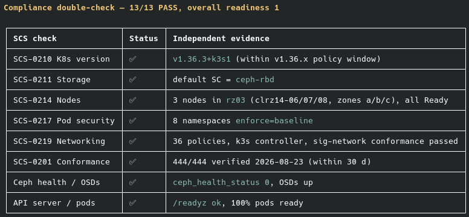
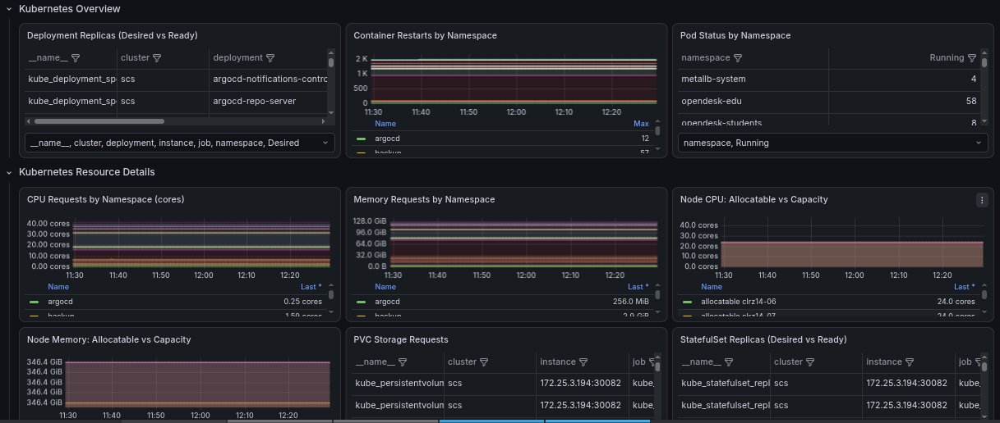
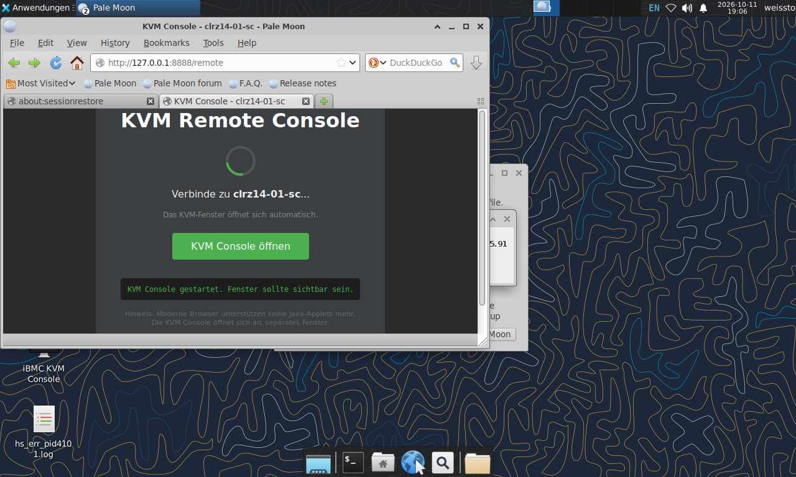

<!-- _class: title -->

<div class="brand">Sovereign Cloud Days 2026 · Workshop Stage</div>

# Agentic AI meets Sovereign Cloud

<div class="sub">openEduSuite on SCS-verified legacy bare-metal hardware</div>

<div class="meta">So, 25.10.2026 · 11:15 · 60 min inkl. Q&A<br>
<span>Tobias Weiß · HRZ Philipps-Universität Marburg</span></div>

<!--
Sprechernotiz: Begrüßung. These: souveränes, KI-fähiges Setup auf abgeschriebenem Eisen.
openEduSuite = HFD-Preisträger 2026. Ablauf: Motivation → Hands-on pi.dev → Cluster → Workload → Q&A.
~50 min Inhalt + 10 min Q&A. [WS]-Marker = Publikums-Interaktion.
-->

---

<div class="kicker">Motivation · 3 min</div>

## Legacy-Hardware ist kein Müll

- Rechenzentren haben **aussortierte Server** — oft voll funktionsfähig.
- Souveränes, KI-fähiges Setup geht auf <span class="accent">abgeschriebenem Eisen</span>.
- 3 × Huawei RH2288E V2 (~2013) → SCS-verified K3s-Cluster.

<div class="card green">openEduSuite: HFD-Ideenwettbewerb Digitale Souveränität — Preisträger 2026-10-06.</div>

<div class="ws"><span class="tag">WS</span>Wer betreibt selbst „Alt-Hardware“ produktiv?</div>

<!--
Sprechernotiz: Kurz halten. Handzeichen aufgreifen. Kein Marketing — ehrlicher Praxisbericht.
HFD-Preis als Vertrauenssignal, nicht als Selbstbeweihräucherung.
-->

---

<div class="kicker">Motivation · Der Pivot · 3 min</div>

## Von OpenStack zu Bare-Metal K3s

<div class="svg-wrap">
<svg viewBox="0 0 1100 200" width="100%">
  <rect x="20" y="40" width="380" height="120" rx="8" fill="#fdeaea" stroke="#c0392b" stroke-width="2"/>
  <text x="210" y="72" text-anchor="middle" font-size="20" font-weight="700" fill="#c0392b">OpenStack / OVN auf VMs</text>
  <text x="210" y="98" text-anchor="middle" font-size="15" fill="#7a3b32">OVN 25.03.1 Gateway-Bug</text>
  <text x="210" y="118" text-anchor="middle" font-size="15" fill="#7a3b32">FIPs tot, DHCP broke</text>
  <text x="210" y="142" text-anchor="middle" font-size="14" fill="#9a4a3a">„Reboot zerstört den Fix“</text>
  <path d="M 415 100 L 525 100" stroke="#5b6b7c" stroke-width="3" fill="none" marker-end="url(#arr)"/>
  <text x="470" y="88" text-anchor="middle" font-size="14" fill="#5b6b7c" font-weight="600">Pivot</text>
  <rect x="540" y="40" width="520" height="120" rx="8" fill="#e8f5ee" stroke="#1a7f6b" stroke-width="2"/>
  <text x="800" y="72" text-anchor="middle" font-size="20" font-weight="700" fill="#1a7f6b">Bare-Metal K3s (SCS-verified)</text>
  <text x="800" y="98" text-anchor="middle" font-size="15" fill="#1a5447">3 Nodes · Flannel · MetalLB · Ceph</text>
  <text x="800" y="118" text-anchor="middle" font-size="15" fill="#1a5447">6/6 KaaS-Standards PASS · 444/444 CNCF</text>
  <text x="800" y="142" text-anchor="middle" font-size="14" fill="#3a6b5e">weniger Layer, weniger Fehlerquellen</text>
  <defs><marker id="arr" markerWidth="10" markerHeight="10" refX="8" refY="5" orient="auto"><path d="M0,0 L10,5 L0,10 z" fill="#5b6b7c"/></marker></defs>
</svg>
</div>

<div class="small center">Die VM-/SDN-Abstraktion war für 3 Nodes zu schwer — bare-metal ist schlanker.</div>

<!--
Sprechernotiz: Lernkurve kurz halten: OVN-Gateway-Redirect-Bug zeigte, dass die Abstraktion
für 3 Nodes zu schwer war. Nicht „OpenStack ist schlecht“, sondern „passte nicht zur Skalierung“.
-->

---

<div class="kicker">Hands-on · pi.dev install · 2 min</div>

## pi installieren

<div class="lead">Ein Befehl genügt — für den Free-Tier ist kein API-Key nötig.</div>

```
curl -fsSL https://pi.dev/install.sh | sh
```

- Alternativ: `npm i -g @earendil-works/pi-coding-agent` (Node 22.19+)
- Prüfen: `pi --version`
- Starten: `cd <projekt> && pi`

<!--
Sprechernotiz: Einstieg in den Hands-on-Teil. Vorab sagen: „Ihr braucht keinen bezahlten API-Key.“
curl-Installer pinnt alle Dependencies. 2 min Zeit lassen, herumgehen, helfen.
-->

---

<div class="kicker">Hands-on · Modell wählen · 3 min</div>

## Kostenlos starten — big pickle

- `/login` → Provider **opencode**
- `/model` → **big pickle** (groß, gratis)
- Oder Free-Tier: `GROQ_API_KEY` / `GOOGLE_API_KEY`

<div class="card green">Der „free big pickle“ reicht für agentische Experimente — kein Kostenrisiko.</div>

<!--
Sprechernotiz: big pickle auf dem opencode-Provider ist kostenlos und groß.
Alternativen: GROQ und Google haben ebenfalls Free-Tier. /thinking für Reasoning-Level,
Ctrl+P zum Modell-Wechseln. Session wird lokal gespeichert.
-->

---

<div class="kicker">Hands-on · Prompt-Ideen · 6 min</div>

## Starter-Prompts zum Ausprobieren

- „Erkläre SCS-0217 Pod-Security in 3 Sätzen.“
- „Schreibe eine default-deny NetworkPolicy für Namespace `llm`.“
- „PVC auf ceph-rbd, 3-fach Replikation — zeige das Manifest.“
- „Ceph ist HEALTH_WARN — gib 3 erste Debug-Schritte.“
- „Skizziere: Studierendenfrage → Retrieval → Ollama-CPU → Antwort.“

<div class="ws"><span class="tag">WS</span>Wer hat pi in 5 Min installiert? → herumgehen, helfen.</div>

<!--
Sprechernotiz: Herzstück des Workshops. 7 Min für eigene Prompts. Bei Rate-Limits auf
GROQ/Google ausweichen. Mit Nachbarn teilen wenn kein Laptop. Fragen für Q&A sammeln.
-->

---

<div class="kicker">Cluster · Hardware · 3 min</div>

## 3 × Huawei RH2288E V2 — ohne GPU

<div class="grid2">
  <div class="kv"><b>CPU</b>2× Xeon E5-2600 v2 (Ivy Bridge-EP) · 6–12 Kerne</div>
  <div class="kv"><b>RAM</b>24× DDR3 ECC RDIMM · max 768 GB</div>
  <div class="kv"><b>Storage</b>6× 512 GB SSD · Ceph 8 OSDs · Repl. 3</div>
  <div class="kv"><b>Netz</b>2× Intel X540 10 GbE · keine GPU</div>
</div>

<figure>

<figcaption class="center">iBMC iMana — Hardware-Ansicht (clrz14-06/07/08)</figcaption>
</figure>

<div class="small center">CPU-Modell / RAM-Größe: nur via iBMC/BIOS auslesbar → [verify]</div>

<!--
Sprechernotiz: Rack clrz14: 8 Server, genutzt 06 (Master) + 07/08 (Worker). ~13 Jahre alt.
Ehrlich: CPU-SKU und RAM-Größe sind [verify]. Kein GPU-Framing — KI-Inferenz läuft auf CPU.
-->

---

<div class="kicker">Cluster · Netzwerk · 3 min</div>

## Drei Netzwerke, eine Firewall

<div class="svg-wrap">
<svg viewBox="0 0 1000 280" width="100%">
  <g font-size="14" font-weight="700" fill="#14202e">
    <rect x="130" y="20" width="120" height="40" rx="5" fill="#e8f0f7" stroke="#0b6e99" stroke-width="2"/>
    <text x="190" y="45" text-anchor="middle">clrz14-06</text>
    <rect x="290" y="20" width="120" height="40" rx="5" fill="#e8f0f7" stroke="#0b6e99" stroke-width="2"/>
    <text x="350" y="45" text-anchor="middle">clrz14-07</text>
    <rect x="450" y="20" width="120" height="40" rx="5" fill="#e8f0f7" stroke="#0b6e99" stroke-width="2"/>
    <text x="510" y="45" text-anchor="middle">clrz14-08</text>
  </g>
  <rect x="40" y="90" width="620" height="46" rx="5" fill="#f0f4f7" stroke="#5b6b7c" stroke-width="1"/>
  <text x="60" y="118" font-size="15" font-weight="700" fill="#5b6b7c">Mgmt RZ24</text>
  <text x="350" y="118" font-size="14" fill="#14202e" text-anchor="middle">172.25.24.36–.38 · ens3f0 untagged · SSH</text>
  <rect x="40" y="150" width="620" height="46" rx="5" fill="#e8f5ee" stroke="#1a7f6b" stroke-width="1"/>
  <text x="60" y="178" font-size="15" font-weight="700" fill="#1a7f6b">Intern</text>
  <text x="350" y="178" font-size="14" fill="#14202e" text-anchor="middle">VLAN 424 · 172.17.0.0/18 · .6/.7/.8 · Flannel VXLAN</text>
  <rect x="40" y="210" width="620" height="46" rx="5" fill="#fff6e8" stroke="#b3560e" stroke-width="1"/>
  <text x="60" y="238" font-size="15" font-weight="700" fill="#b3560e">FIP RZ03</text>
  <text x="350" y="238" font-size="14" fill="#14202e" text-anchor="middle">172.25.3.181–.196 · MetalLB L2 · .181 haproxy · .182 argocd · .183–.186 …</text>
  <rect x="700" y="90" width="260" height="166" rx="5" fill="#fdeaea" stroke="#c0392b" stroke-width="1.5"/>
  <text x="830" y="118" text-anchor="middle" font-size="15" font-weight="700" fill="#c0392b">SCS-FIREWALL</text>
  <text x="830" y="142" text-anchor="middle" font-size="13" fill="#7a3b32">allow: 80/443/22</text>
  <text x="830" y="160" text-anchor="middle" font-size="13" fill="#7a3b32">5001/31080/31443</text>
  <text x="830" y="178" text-anchor="middle" font-size="13" fill="#7a3b32">123/ICMP</text>
  <text x="830" y="200" text-anchor="middle" font-size="13" fill="#7a3b32">drop: 6443/10250</text>
  <text x="830" y="218" text-anchor="middle" font-size="13" fill="#7a3b32">8472</text>
</svg>
</div>

<div class="small center">ens3f0: Mgmt + FIP (VLAN 3) · ens6f0: intern (VLAN 424) · iBMC Out-of-Band</div>

<!--
Sprechernotiz: Drei Netzwerke auf 2× 10 GbE. Mgmt RZ24 (SSH), intern VLAN 424 (K3s-Pods),
FIP RZ03 (MetalLB L2, externe Services). Firewall auf ens3f0. iBMC separat (Out-of-Band).
-->

---

<div class="kicker">Cluster · K3s-Stack · 4 min</div>

## Der Stack — bare-metal im Betrieb

<div class="svg-wrap">
<svg viewBox="0 0 700 360" width="100%">
  <g font-size="18" font-weight="700" text-anchor="middle">
    <rect x="40" y="10"  width="620" height="44" rx="6" fill="#0b6e99"/><text x="350" y="38" fill="#fff">openEduSuite Workloads (edu · staff · students · sme · llm)</text>
    <rect x="40" y="62"  width="620" height="44" rx="6" fill="#1a7f6b"/><text x="350" y="90" fill="#fff">ArgoCD (GitOps) · K8up/Restic (Backup → SeaweedFS S3)</text>
    <rect x="40" y="114" width="620" height="44" rx="6" fill="#e8f0f7" stroke="#0b6e99"/><text x="350" y="142" fill="#14202e">Ceph 18.2.8 Reef — 8 OSDs, RBD + CephFS, Repl. 3</text>
    <rect x="40" y="166" width="620" height="44" rx="6" fill="#e8f0f7" stroke="#0b6e99"/><text x="350" y="194" fill="#14202e">Flannel VXLAN · MetalLB L2 · HAProxy Ingress</text>
    <rect x="40" y="218" width="620" height="44" rx="6" fill="#e8f0f7" stroke="#0b6e99"/><text x="350" y="246" fill="#14202e">K3s v1.36.3+k3s1 · Single-Server · eingebetteter Datastore</text>
    <rect x="40" y="270" width="620" height="44" rx="6" fill="#f0f4f7" stroke="#5b6b7c"/><text x="350" y="298" fill="#5b6b7c">Ubuntu 24.04 LTS · containerd 2.3.3 · runc 1.4.3</text>
    <rect x="40" y="322" width="620" height="34" rx="6" fill="#1a1a1a"/><text x="350" y="344" fill="#fff" font-size="15">3 × Huawei RH2288E V2 (bare metal)</text>
  </g>
</svg>
</div>

<div class="small center">444/444 CNCF Conformance · 6/6 SCS KaaS-Standards · DevSecOps 78/100</div>

<!--
Sprechernotiz: Von unten nach oben lesen: Blech → OS → K3s → CNI/LB → Ceph → GitOps → Workloads.
Alles real im Betrieb, kein Lab. ArgoCD managt ~40 Workloads. K3s-Datastore: eingebettet ([verify]).
-->

---

<div class="kicker">Cluster · SCS-verified · 2 min</div>

## 6/6 KaaS-Standards PASS — messbar

<figure>

<figcaption class="center">SCS KaaS Compliance-Check (2026-08-23)</figcaption>
</figure>

- **SCS-0201** CNCF 444/444 · **0210** v1.36.3 · **0211** ceph-rbd
- **0214** 3 Nodes · **0217** Pod-Security · **0219** Networking

<div class="card warn">Offen: OIDC als 2. Auth · Pod-Security 17/22 NS · Loki/Trivy-CI · Ceph-at-rest · DSGVO-Freigabe.</div>

<!--
Sprechernotiz: „Verified“ = messbare Tests, kein Bullshit-Bingo. Aber die offenen Lücken klar
benennen — das ist das Verkaufsargument bei Behörden/Unis. DSGVO: Cluster noch NICHT für
personenbezogene Daten freigegeben.
-->

---

<div class="kicker">Cluster · Betrieb · 2 min</div>

## Was wir im Betrieb gelernt haben

<figure>

<figcaption class="center">Grafana K3s-Dashboard (7 Dashboards, predictive-agent)</figcaption>
</figure>

- Stale Digests, default-deny NetworkPolicies, OIDC-Migration — alle gelöst und dokumentiert
- Updates: Ceph-first, rollierend, Rollback-Skript · Backup: K8up → SeaweedFS S3

<!--
Sprechernotiz: Positiv rahmen: jeder Stolperstein wurde gelöst und dokumentiert.
Firewall: SCS-FIREWALL auf ens3f0. 2–3 Lektionen als Story, nicht als Klage.
-->

---

<div class="kicker">openEduSuite · Workload · 4 min</div>

## Souveräne Bildungsplattform, multi-tenant

<div class="grid2">
  <div class="kv"><b>Tenants</b>edu · staff · students · sme · llm · predictive-agent</div>
  <div class="kv"><b>Auth</b>Keycloak / OIDC · OpenLDAP (.186)</div>
  <div class="kv"><b>E-Mail</b>Postfix (.185) · Stalwart (.183) · DKIMpy (.184)</div>
  <div class="kv"><b>Kollaboration</b>Nextcloud · XWiki · Matrix · SOGo6 · OpenProject</div>
</div>

<div class="small">Images: eigene Nix-Builds auf GHCR → lokale Zot-Registry. `opendesk-sme` noch Degraded (stale Digests).</div>

<!--
Sprechernotiz: Multi-Tenant-Plattform für Bildung. Auth über Keycloak/OIDC.
E-Mail-Stack komplett souverän. opendesk-sme ehrlich als Degraded benennen.
-->

---

<div class="kicker">openEduSuite · Agentic Workflow · 4 min</div>

## Lern-Kurzantwort in 4 Schritten

<div class="svg-wrap">
<svg viewBox="0 0 1100 200" width="100%">
  <g font-size="15" font-weight="600" text-anchor="middle">
    <rect x="20" y="50" width="200" height="100" rx="8" fill="#e8f0f7" stroke="#0b6e99" stroke-width="2"/>
    <text x="120" y="80" fill="#0b6e99" font-weight="700">1 · Frage</text>
    <text x="120" y="105" fill="#14202e" font-size="13">Studierendenfrage</text>
    <text x="120" y="125" fill="#5b6b7c" font-size="13">open-webui (ns llm)</text>
    <path d="M 225 100 L 285 100" stroke="#5b6b7c" stroke-width="2.5" fill="none" marker-end="url(#arr2)"/>
    <rect x="290" y="50" width="200" height="100" rx="8" fill="#e8f5ee" stroke="#1a7f6b" stroke-width="2"/>
    <text x="390" y="80" fill="#1a7f6b" font-weight="700">2 · Retrieval</text>
    <text x="390" y="105" fill="#14202e" font-size="13">Kursmaterial</text>
    <text x="390" y="125" fill="#5b6b7c" font-size="13">+ Prometheus-Metriken</text>
    <path d="M 495 100 L 555 100" stroke="#5b6b7c" stroke-width="2.5" fill="none" marker-end="url(#arr2)"/>
    <rect x="560" y="50" width="200" height="100" rx="8" fill="#fff6e8" stroke="#b3560e" stroke-width="2"/>
    <text x="660" y="80" fill="#b3560e" font-weight="700">3 · Inferenz</text>
    <text x="660" y="105" fill="#14202e" font-size="13">Ollama auf CPU</text>
    <text x="660" y="125" fill="#5b6b7c" font-size="13">quantisiertes Modell</text>
    <path d="M 765 100 L 825 100" stroke="#5b6b7c" stroke-width="2.5" fill="none" marker-end="url(#arr2)"/>
    <rect x="830" y="50" width="250" height="100" rx="8" fill="#e8f0f7" stroke="#0b6e99" stroke-width="2"/>
    <text x="955" y="80" fill="#0b6e99" font-weight="700">4 · Antwort + Quellen</text>
    <text x="955" y="105" fill="#14202e" font-size="13">mit Quellenangabe</text>
    <text x="955" y="125" fill="#5b6b7c" font-size="13">an die Nutzerin</text>
  </g>
  <defs><marker id="arr2" markerWidth="10" markerHeight="10" refX="8" refY="5" orient="auto"><path d="M0,0 L10,5 L0,10 z" fill="#5b6b7c"/></marker></defs>
</svg>
</div>

<div class="card green" style="font-size:18px"><strong>predictive-agent v8.11-nix:</strong> Risk-Scoring (Kalman + Markov) für 62 Pods — proaktives Alerting.</div>

<!--
Sprechernotiz: „Agentic“ = tool-nutzend, mehrschrittig (Retrieval → Inferenz → Verifikation),
kein Einzel-Prompt. Der Agent trägt den Cluster-Zustand mit — die Brücke
„Agentic AI meets Sovereign Cloud“. Modellname [verify].
-->

---

<div class="kicker">openEduSuite · Live-Demo · 4 min</div>

## Cluster, Login, Agent-Trace

<figure>

<figcaption class="center">Live iBMC KVM-Konsole — Server-Console via Pale Moon + Java Web Start</figcaption>
</figure>

- Dashboard: 3 Nodes · Ceph HEALTH OK (8/8) · SCS-Board
- Login via Keycloak/OIDC → agentischer Workflow

<div class="card warn"><strong>Fallback:</strong> Screencast + Architektur-Diagramm, falls die Demo hakt.</div>

<!--
Sprechernotiz: Vorher testen: Tunnel/Login, Ceph-Status, open-webui.
Bei Haken: ruhig auf Fallback umschalten. Zeit im Blick — 4 Min. hart.
-->

---

<div class="kicker">Lessons · 3 min</div>

## Fünf Dinge zum Mitnehmen

- **Fang klein an, lerne schnell** — OpenStack passte nicht zur Skalierung.
- **Bare metal statt VM-Schicht** — weniger Abstraktion, mehr Kontrolle.
- **Constraints sind Features** — Quantisierung schlägt GPU-Käufe.
- **„Verified“ überzeugt** — SCS-Tests öffnen Türen, mit ehrlichem Lücken-Reporting.
- **Dokumentiere wie ein Verrückter** — Runbooks, DSFA, Checklisten.

<!--
Sprechernotiz: Essenz. Punkt 4 betonen: Verified öffnet Türen bei Behörden/Unis — aber nur
mit ehrlichen Lücken. Punkt 5: Runbooks, DSFA, Checklisten — sonst ist Wissen eine Einbahnstraße.
-->

---

<div class="kicker">Q&A · 10 min</div>

## Fragen & Diskussion

- Architektur, Nachbauen, SCS-/openEduSuite-Lizenzthemen
- Hands-on: pi.dev-Installation und Prompts aus dem Workshop
- Kontakt: tobias-weiss.org · graphwiz.ai · ki-kompetenz-training.org

<div class="card green"><strong>Backup-Folien:</strong> Architektur-Diagramm · Agent-Trace · Screencast · Cluster-Faktenblatt.</div>

<!--
Sprechernotiz: Q&A-Moderation: „What if“-Fragen sammeln. Bei Detailfragen zu [verify]-Werten
ehrlich auf Quelle/iBMC verweisen. Backup-Folien bereithalten. Kontakt-Links für Follow-up.
-->
