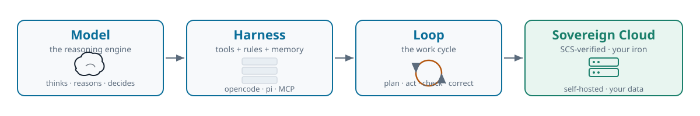
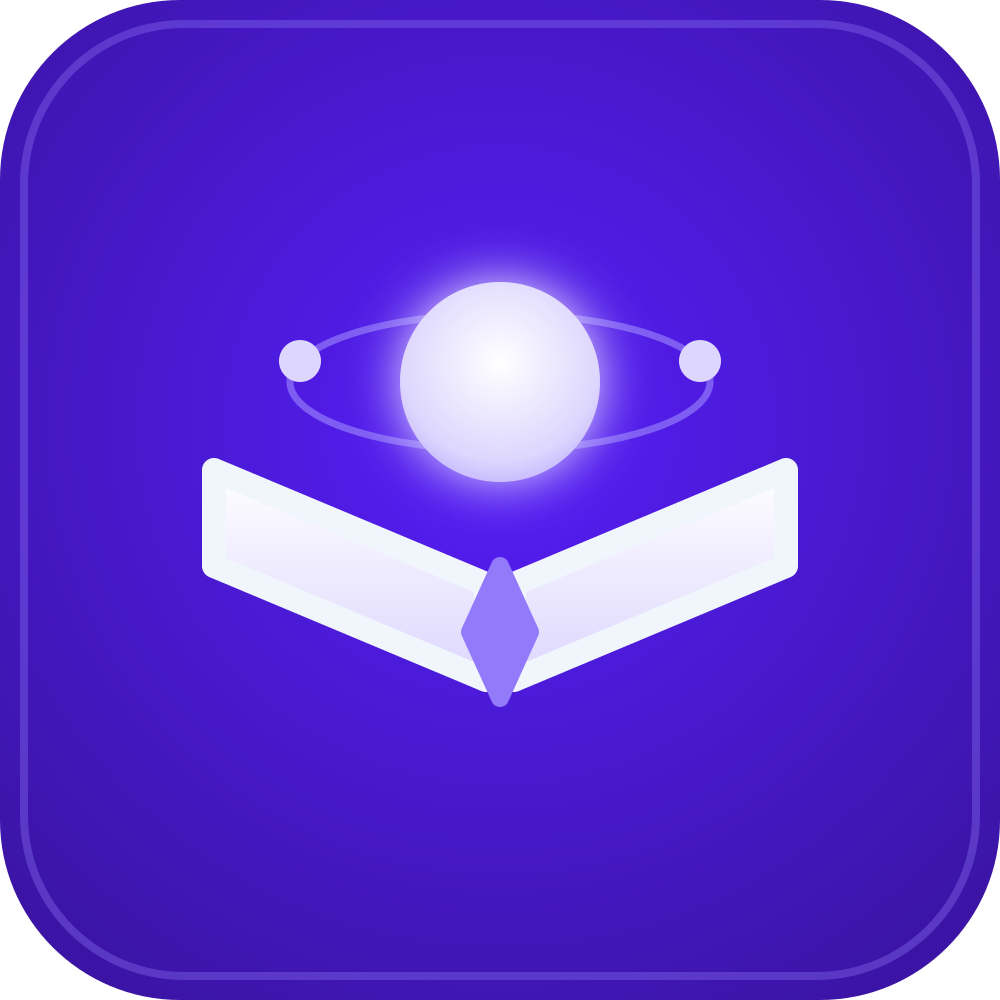
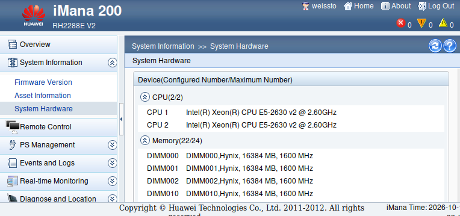
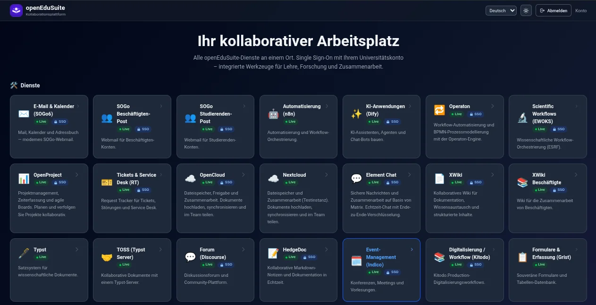
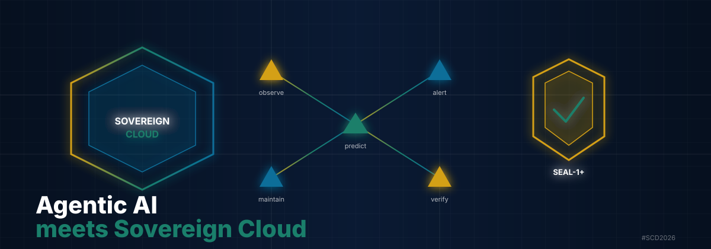

<div class="brand">Sovereign Cloud Days 2026 · Workshop Stage</div>

# Agentic AI meets Sovereign Cloud

<div class="sub">openEduSuite on SCS-verified legacy bare-metal hardware</div>

<div class="meta">Sun, 25.10.2026 · 11:15 · 60 min incl. Q&A<br>
<span>Tobias Weiß</span></div>



<!--
Speaker note: Welcome. Thesis: a sovereign, AI-capable setup on written-off iron.
openEduSuite = HFD award winner 2026. Agenda: motivation → hands-on opencode → cluster → workload → Q&A.
~50 min content + 10 min Q&A. [WS] marker = audience interaction.
-->

---

<div class="kicker">Context · project comparison</div>

## Yaook vs. OSISM — two paths to sovereign OpenStack

<div class="grid2">
  <div class="card">
    <strong>Yaook</strong> · <span class="small">yaook.cloud</span><br>
    OpenStack <em>IN</em> Kubernetes (CRDs)<br>
    ~12 core services · kubectl + yaookctl<br>
    K8s-native, declarative, rolling releases<br>
    Metal Controller + Netbox · CUE validation
  </div>
  <div class="card green">
    <strong>OSISM</strong> · <span class="small">osism.tech</span><br>
    OpenStack <em>ALONGSIDE</em> Kubernetes (Ansible)<br>
    ~25 services · Web UI + Manager CLI (38 cmds)<br>
    Full ops suite · 15+ security/monitoring tools<br>
    Metalbox + Ironic + SONIC · CUE (adopted from Yaook)
  </div>
</div>

<div class="small center">SCS: OSISM is the reference implementation; Yaook is an SCS member. Both Apache 2.0 · European.</div>

<!--
Speaker note: We compared both for openEduSuite. Picked bare-metal K3s instead of either
full IaaS stack — lighter for 3 nodes, but the comparison informed our storage/network choices.
-->

---

<div class="kicker">Motivation · 3 min</div>

## Legacy hardware isn't junk

- Data centers have **decommissioned servers** — often fully functional.
- A sovereign, AI-capable setup runs on <span class="accent">written-off iron</span>.
- 3 × Huawei RH2288E V2 (~2013) → SCS-verified K3s cluster.

<div class="card green">openEduSuite: HFD Digital Sovereignty Ideas Competition — winner 2026-10-06.</div>

<div style="display:flex; gap:24px; align-items:center; margin:8px 0;">
  
  <ul style="margin:0; font-size:18px; line-height:1.4;">
    <li>Whole sovereign workplace — identity, mail, collaboration, delivery</li>
    <li>Real FOSS components</li>
    <li>Verified against SCS (6/6 KaaS standards PASS)</li>
  </ul>
</div>

<div class="ws"><span class="tag">WS</span>Who runs “legacy hardware” in production themselves?</div>

<!--
Speaker note: Keep it short. Acknowledge the show of hands. No marketing — an honest field report.
The HFD prize as a signal of trust, not self-congratulation.
-->

---

<div class="kicker">Motivation · The pivot · 3 min</div>

## From OpenStack to bare-metal K3s

<div class="svg-wrap">
<svg viewBox="0 0 1100 200" width="100%">
  <rect x="20" y="40" width="380" height="120" rx="8" fill="#fdeaea" stroke="#c0392b" stroke-width="2"/>
  <text x="210" y="72" text-anchor="middle" font-size="20" font-weight="700" fill="#c0392b">OpenStack / OVN on VMs</text>
  <text x="210" y="98" text-anchor="middle" font-size="15" fill="#7a3b32">OVN 25.03.1 gateway bug</text>
  <text x="210" y="118" text-anchor="middle" font-size="15" fill="#7a3b32">FIPs dead, DHCP broke</text>
  <text x="210" y="142" text-anchor="middle" font-size="14" fill="#9a4a3a">“Reboot destroys the fix”</text>
  <path d="M 415 100 L 525 100" stroke="#5b6b7c" stroke-width="3" fill="none" marker-end="url(#arr)"/>
  <text x="470" y="88" text-anchor="middle" font-size="14" fill="#5b6b7c" font-weight="600">Pivot</text>
  <rect x="540" y="40" width="520" height="120" rx="8" fill="#e8f5ee" stroke="#1a7f6b" stroke-width="2"/>
  <text x="800" y="72" text-anchor="middle" font-size="20" font-weight="700" fill="#1a7f6b">Bare-metal K3s (SCS-verified)</text>
  <text x="800" y="98" text-anchor="middle" font-size="15" fill="#1a5447">3 nodes · Flannel · MetalLB · Ceph</text>
  <text x="800" y="118" text-anchor="middle" font-size="15" fill="#1a5447">6/6 KaaS standards PASS · 444/444 CNCF</text>
  <text x="800" y="142" text-anchor="middle" font-size="14" fill="#3a6b5e">fewer layers, fewer failure points</text>
  <defs><marker id="arr" markerWidth="10" markerHeight="10" refX="8" refY="5" orient="auto"><path d="M0,0 L10,5 L0,10 z" fill="#5b6b7c"/></marker></defs>
</svg>
</div>

<div class="card warn" style="font-size:16px; margin:8px 0 6px 0">
<strong>What broke in OVN 25.03.1:</strong> gateway redirect bug · floating IPs (FIPs) unreachable · DHCP leases lost · OVN northd/southbound DB + OVS bridges on every node · “reboot destroys the fix” — every node restart re-triggered it.
</div>
<div class="small center">The VM/SDN abstraction was too heavy for 3 nodes — bare metal is leaner.</div>

<!--
Speaker note: Keep the learning curve brief: the OVN gateway redirect bug showed that the abstraction
was too heavy for 3 nodes. Not “OpenStack is bad,” but “it didn't fit the scale.”
-->

---

<div class="kicker">Hands-on · Install · 2 min</div>

## Install your tool — pick one

<div class="grid2">
  <div>
    <div class="card green"><b>Beginners · opencode</b></div>

```bash
curl -fsSL https://opencode.ai/install | bash
# Or: npm install -g opencode-ai
# Or: bun add -g opencode-ai (much faster)
# Verify: opencode --version
# Start: cd <project> && opencode
```
  </div>
  <div>
    <div class="card"><b>Advanced · pi.dev</b></div>

```bash
curl -fsSL https://pi.dev/install.sh | sh
# Or: npm i -g @earendil-works/pi-coding-agent (Node 22.19+)
# Or: bun add -g @earendil-works/pi-coding-agent (much faster)
# Verify: pi --version
# Start: cd <project> && pi
```
  </div>
</div>

<div class="small center">Both are free to start — no paid API key required. Using <strong>bun</strong> gives a noticeable speedup.</div>

<!--
Speaker note: Start of the workshop element. Say upfront: “You don't need a paid API key.”
Allow 2 min, walk around, help.
-->

---

<div class="kicker">Hands-on · Choosing a model · 3 min</div>

## Start for free — Big Pickle or Beam

- **opencode (beginners):** `/connect` → **OpenCode Zen** → pick **Big Pickle** or **Beam Free**
- **pi.dev (advanced):** `/login` → provider **opencode**, then `/model` → `big-pickle` or `beam-free`
- Alternatives: any provider via `/connect` (75+) or your own API key

<div class="card green">Both are free on OpenCode Zen — enough for agentic experiments, no cost risk.</div>

<div class="card warn">⚠️ <strong>Privacy — read before you paste.</strong> Free cloud models differ in how they handle your data. <strong>Big Pickle</strong> is a stealth model; its provider <em>may use your input to train</em>. <strong>Beam Free</strong> (Reflection's open-weight 501B model, 1M-token context) does <strong>not</strong> train on your data (retains it 30 days for safety). <strong>Never paste private, customer, or unpublished data into a model that trains on user input.</strong> For sensitive work, run a local model (Ollama, <code>ollama run beam</code>) or your own sovereign endpoint.</div>

<!--
Speaker note: Big Pickle and Beam Free are both on OpenCode Zen's free list
(lineup rotates — check opencode.ai/zen). Big Pickle is a stealth model whose
provider may train on your input; Beam Free (Reflection's open-weight 501B MoE,
Apache 2.0, 1M-token context) does not train on your data but retains it 30 days.
The privacy line matters: this is a sovereign-cloud workshop — never paste private
or customer data into a model that trains on user input. For sensitive work, run
Ollama locally (ollama run beam — Beam is on Ollama too, zero data retention) or
your own sovereign endpoint. Alternatives: own provider key via /connect (outside
the TUI: opencode auth login). Switch models with /models. Sessions are stored
locally. If opencode.ai does not resolve on the workshop network, set DNS to
1.1.1.1 / 8.8.8.8 or add a hosts entry: `dig +short opencode.ai @1.1.1.1` then
append `<IP> opencode.ai` to /etc/hosts (verified 19 Oct 2026: 172.65.90.20).
-->

---

<div class="kicker">Quality · Spec-driven · 3 min</div>

## Spec → Contract → Test pyramid

<div class="svg-wrap">
<svg viewBox="0 0 600 320" width="60%" style="max-height:260px">
  <!-- pyramid: 3 layers, top small, bottom wide -->
  <polygon points="300,20 120,120 480,120" fill="#e8f0f7" stroke="#0b6e99" stroke-width="2"/>
  <text x="300" y="80" text-anchor="middle" font-size="16" font-weight="700" fill="#0b6e99">Spec (few)</text>
  <text x="300" y="100" text-anchor="middle" font-size="12" fill="#14202e">via openspec</text>
  <polygon points="120,125 480,125 520,225 80,225" fill="#e8f5ee" stroke="#1a7f6b" stroke-width="2"/>
  <text x="300" y="180" text-anchor="middle" font-size="16" font-weight="700" fill="#1a7f6b">Contracts (many)</text>
  <polygon points="80,230 520,230 560,300 40,300" fill="#fff6e8" stroke="#b3560e" stroke-width="2"/>
  <text x="300" y="270" text-anchor="middle" font-size="16" font-weight="700" fill="#b3560e">Tests (many · many)</text>
</svg>
</div>

<div class="kv" style="font-size:18px"><b>Spec</b> (few) — the single source of truth, written with openspec.</div>
<div class="kv" style="font-size:18px"><b>Contracts</b> (many) — derived from the spec, agreed between producer and consumer.</div>
<div class="kv" style="font-size:18px"><b>Tests</b> (many · many) — fast, cheap, run on every change; the broad base.</div>

<!--
Speaker note: The pyramid keeps the expensive, slow things (spec review) at the top and the
cheap, fast things (tests) at the base. Spec via openspec → contracts → tests. Few specs,
many contracts, many-many tests. Inverts the usual “write tests first” reflex: agree the spec
and contract first, then let tests enforce them.
-->

---
<div class="kicker">Cluster · Hardware · 3 min</div>

## 3 × Huawei RH2288E V2 — no GPU

<div class="grid2">
  <div class="kv"><b>CPU</b>2× Xeon E5-2600 v2 (Ivy Bridge-EP) · 6–12 cores</div>
  <div class="kv"><b>RAM</b>24× DDR3 ECC RDIMM · max 768 GB</div>
  <div class="kv"><b>Storage</b>6× 512 GB SSD · Ceph 8 OSDs · Repl. 3</div>
  <div class="kv"><b>Network</b>2× Intel X540-AT2 10 GbE</div>
</div>

<figure>

<figcaption class="center">iBMC iMana — hardware view (host1/host2/host3)</figcaption>
</figure>

<!--
Speaker note: Rack: 8 servers, host1 (master) + host2/host3 (worker) in use. ~13 years old.
Honestly: CPU SKU and RAM size are [verify]. No GPU framing — AI inference runs on CPU.
-->
---

<div class="kicker">Cluster · Network · 3 min</div>

## Three networks, one firewall

<div class="svg-wrap">
<svg viewBox="0 0 1000 280" width="100%">
  <defs>
    <marker id="net-ar" markerWidth="8" markerHeight="8" refX="7" refY="3" orient="auto">
      <path d="M0,0 L7,3 L0,6 Z" fill="#5b6b7c"/>
    </marker>
  </defs>
  <!-- LEFT: external-facing networks (Mgmt + FIP) -->
  <rect x="30" y="30" width="180" height="45" rx="6" fill="#f0f4f7" stroke="#5b6b7c" stroke-width="2"/>
  <text x="120" y="50" text-anchor="middle" font-size="14" font-weight="700" fill="#5b6b7c">Mgmt</text>
  <text x="120" y="66" text-anchor="middle" font-size="10" fill="#14202e">SSH · ens3f0 untagged</text>
  <rect x="30" y="205" width="180" height="45" rx="6" fill="#fff6e8" stroke="#b3560e" stroke-width="2"/>
  <text x="120" y="225" text-anchor="middle" font-size="14" font-weight="700" fill="#b3560e">FIP</text>
  <text x="120" y="241" text-anchor="middle" font-size="10" fill="#14202e">MetalLB L2 · external</text>
  <!-- LEFT SWITCH (10 GbE) -->
  <rect x="225" y="95" width="70" height="90" rx="6" fill="#e8eef3" stroke="#0b6e99" stroke-width="2"/>
  <text x="260" y="130" text-anchor="middle" font-size="12" font-weight="700" fill="#0b6e99">Switch</text>
  <text x="260" y="148" text-anchor="middle" font-size="11" font-weight="700" fill="#0b6e99">10 GbE</text>
  <!-- Mgmt/FIP -> left switch -->
  <line x1="210" y1="52" x2="225" y2="110" stroke="#5b6b7c" stroke-width="2" marker-end="url(#net-ar)"/>
  <line x1="210" y1="227" x2="225" y2="170" stroke="#5b6b7c" stroke-width="2" marker-end="url(#net-ar)"/>
  <!-- CENTER: 3 servers (vertical stack) -->
  <g font-size="14" font-weight="700" fill="#14202e">
    <rect x="315" y="30" width="170" height="55" rx="6" fill="#e8f0f7" stroke="#0b6e99" stroke-width="2"/>
    <text x="400" y="62" text-anchor="middle" fill="#0b6e99">host1</text>
    <text x="400" y="78" text-anchor="middle" font-size="10" fill="#c0392b">SCS-FIREWALL</text>
    <rect x="315" y="112" width="170" height="55" rx="6" fill="#e8f0f7" stroke="#0b6e99" stroke-width="2"/>
    <text x="400" y="144" text-anchor="middle" fill="#0b6e99">host2</text>
    <text x="400" y="160" text-anchor="middle" font-size="10" fill="#c0392b">SCS-FIREWALL</text>
    <rect x="315" y="195" width="170" height="55" rx="6" fill="#e8f0f7" stroke="#0b6e99" stroke-width="2"/>
    <text x="400" y="227" text-anchor="middle" fill="#0b6e99">host3</text>
    <text x="400" y="243" text-anchor="middle" font-size="10" fill="#c0392b">SCS-FIREWALL</text>
  </g>
  <!-- left switch -> servers -->
  <line x1="295" y1="110" x2="315" y2="57" stroke="#5b6b7c" stroke-width="2" marker-end="url(#net-ar)"/>
  <line x1="295" y1="140" x2="315" y2="139" stroke="#5b6b7c" stroke-width="2" marker-end="url(#net-ar)"/>
  <line x1="295" y1="170" x2="315" y2="222" stroke="#5b6b7c" stroke-width="2" marker-end="url(#net-ar)"/>
  <!-- servers -> right switch -->
  <line x1="485" y1="57" x2="505" y2="110" stroke="#5b6b7c" stroke-width="2" marker-end="url(#net-ar)"/>
  <line x1="485" y1="139" x2="505" y2="140" stroke="#5b6b7c" stroke-width="2" marker-end="url(#net-ar)"/>
  <line x1="485" y1="222" x2="505" y2="170" stroke="#5b6b7c" stroke-width="2" marker-end="url(#net-ar)"/>
  <!-- RIGHT SWITCH (10 GbE) -->
  <rect x="505" y="95" width="70" height="90" rx="6" fill="#e8eef3" stroke="#0b6e99" stroke-width="2"/>
  <text x="540" y="130" text-anchor="middle" font-size="12" font-weight="700" fill="#0b6e99">Switch</text>
  <text x="540" y="148" text-anchor="middle" font-size="11" font-weight="700" fill="#0b6e99">10 GbE</text>
  <!-- right switch -> internal (Ceph) -->
  <line x1="575" y1="140" x2="595" y2="140" stroke="#5b6b7c" stroke-width="2" marker-end="url(#net-ar)"/>
  <!-- RIGHT: internal network (Ceph only) -->
  <rect x="595" y="20" width="375" height="240" rx="6" fill="#e8f5ee" stroke="#1a7f6b" stroke-width="2"/>
  <text x="782" y="55" text-anchor="middle" font-size="16" font-weight="700" fill="#1a7f6b">Internal — Ceph only</text>
  <text x="782" y="80" text-anchor="middle" font-size="12" fill="#14202e">198.51.100.0/18 · .11/.12/.13 · ens6f0</text>
  <text x="782" y="100" text-anchor="middle" font-size="12" fill="#14202e">Ceph cluster traffic · replication · heartbeats</text>
  <text x="782" y="125" text-anchor="middle" font-size="12" fill="#14202e">two physically separated switches (internal / external)</text>
  <text x="782" y="150" text-anchor="middle" font-size="12" fill="#14202e">iBMC out-of-band</text>
  <text x="782" y="245" text-anchor="middle" font-size="11" fill="#5b6b7c">not reachable from external · no K3s pods on this net</text>
</svg>
</div>

<div class="small center">Left: Mgmt + FIP (external) → Switch 10G → 3 nodes (SCS-FIREWALL) → Switch 10G → Right: Internal (Ceph only) · 2 phys. switches · iBMC OOB</div>

<!--
Speaker note: Three networks on 2× 10 GbE. Left: Mgmt (SSH) + FIP (MetalLB L2, external)
reach the 3 nodes (SCS-FIREWALL runs on each host); right: Internal (Ceph only).
Internal and external run on two physically separated switches. iBMC separate (out-of-band).
-->

---

<div class="kicker">Cluster · K3s stack · 4 min</div>

## The stack — bare-metal in production

<div class="svg-wrap">
<svg viewBox="0 0 700 292" width="100%">
  <g font-size="17" font-weight="700" text-anchor="middle">
    <rect x="40" y="6"   width="620" height="36" rx="6" fill="#0b6e99"/><text x="350" y="30" fill="#fff">openEduSuite Workloads (edu · staff · students · sme · llm)</text>
    <rect x="40" y="48"  width="620" height="36" rx="6" fill="#1a7f6b"/><text x="350" y="72" fill="#fff">ArgoCD (GitOps) · K8up/Restic (backup → SeaweedFS S3)</text>
    <rect x="40" y="90"  width="620" height="36" rx="6" fill="#e8f0f7" stroke="#0b6e99"/><text x="350" y="114" fill="#14202e">Ceph 18.2.8 Reef — 8 OSDs, RBD + CephFS, Repl. 3</text>
    <rect x="40" y="132" width="620" height="36" rx="6" fill="#e8f0f7" stroke="#0b6e99"/><text x="350" y="156" fill="#14202e">Flannel VXLAN · MetalLB L2 · HAProxy Ingress</text>
    <rect x="40" y="174" width="620" height="36" rx="6" fill="#e8f0f7" stroke="#0b6e99"/><text x="350" y="198" fill="#14202e">K3s v1.36.3+k3s1 · Single-server · embedded datastore</text>
    <rect x="40" y="216" width="620" height="36" rx="6" fill="#f0f4f7" stroke="#5b6b7c"/><text x="350" y="240" fill="#5b6b7c">Ubuntu 24.04 LTS · containerd 2.3.3 · runc 1.4.3</text>
    <rect x="40" y="258" width="620" height="28" rx="6" fill="#1a1a1a"/><text x="350" y="277" fill="#fff" font-size="15">3 × Huawei RH2288E V2 (bare metal)</text>
  </g>
</svg>
</div>

<!--
Speaker note: Read from the bottom up: metal → OS → K3s → CNI/LB → Ceph → GitOps → workloads.
All real in production, not a lab. ArgoCD manages ~40 workloads. K3s datastore: embedded ([verify]).
Compliance numbers come on the next slide — don't preempt them here.
-->

---

<div class="kicker">Cluster · SCS-verified · 3 min</div>

## 6/6 KaaS standards PASS — measurable

| Standard | Test | Result |
|---|---|---|
| **SCS-0201** CNCF conformance | `cncf-k8s-conformance` (444/444 specs) | ✅ PASS |
| **SCS-0210** version policy | `version-policy-check` (v1.36.3 in window) | ✅ PASS |
| **SCS-0211** default storage class | manual (ceph-rbd, repl. 3) | ✅ PASS |
| **SCS-0214** node distribution | manual (3 nodes, zones a/b/c) | ✅ PASS |
| **SCS-0217** pod security | manual (8 NS baseline; 2 system NS privileged) | ✅ PASS |
| **SCS-0219** KaaS networking | `kaas-networking-check` (37 NetworkPolicies) | ✅ PASS |

<div class="small center" style="font-size:14px; margin:4px 0 2px 0; color:var(--warn); font-weight:600">Open: OIDC as 2nd auth · Pod-Security on more NS · Loki/Trivy CI · Ceph at rest · GDPR clearance.</div>

<div class="small center" style="font-size:13px; margin:2px 0 4px 0">Criteria &amp; tests: <a href="https://github.com/SovereignCloudStack/standards">github.com/SovereignCloudStack/standards</a></div>

<div class="small center" style="font-size:12px; margin:2px 0 4px 0; color:var(--muted)">Footnote — PRs to SCS: <a href="https://github.com/SovereignCloudStack/standards/pull/1267">standards #1267</a> (bare-metal K3s notes for SCS-0217) · <a href="https://github.com/SovereignCloudStack/docs/pull/397">docs #397</a> (deployment guide).</div>

<!--
Speaker note: “Verified” = measurable tests, no bullshit bingo. But name the open gaps clearly
— that's the selling point with public authorities and universities. GDPR: the cluster is NOT
yet cleared for personal data.
-->

---

<div class="kicker">openEduSuite · Workload · 4 min</div>

## The dimensions of openEduSuite

<div style="display:flex; align-items:center; justify-content:space-between; gap:16px; margin:4px 0 8px 0">
  <div style="display:flex; align-items:center; gap:10px"><a href="https://openedusuite.org" style="font-size:18px; font-weight:600">openedusuite.org</a></div>
  
</div>

| Dimension | Components |
|---|---|
| **Tenants — who** | edu · staff · students · sme · llm · predictive-agent |
| **Identity & access** | Keycloak / OIDC · OpenLDAP |
| **Communication** | Postfix · Stalwart · DKIMpy · Matrix |
| **Collaboration** | Nextcloud · XWiki · SOGo · OpenProject · Typst · Toss |
| **Workflows** | Dify · n8n · Ewoks |
| **Delivery** | Own Nix builds on GHCR → local Zot registry · ArgoCD |

<!--
Speaker note: The platform in five sorted dimensions: who (tenants), identity,
communication, collaboration, delivery. Auth via Keycloak/OIDC. Email stack
fully sovereign. Honestly call out opendesk-sme as Degraded.
-->

---

<div class="kicker">openEduSuite · Live demo · 4 min</div>

## Cluster, login, agent trace

<figure>

<figcaption class="center">openEduSuite — agentic AI meets sovereign cloud</figcaption>
</figure>

<div class="center" style="font-size:15px; margin:4px 0 6px 0; font-style:italic">Your collaborative workplace — all openEduSuite services in one place, single sign-on with your university account.</div>

- Dashboard: 3 nodes · Ceph HEALTH OK (8/8) · SCS board
- Login via Keycloak/OIDC → agentic workflow

<div class="card warn"><strong>Fallback:</strong> Screenshots (Grafana, KVM, open-webui) + stack diagram if the demo stalls.</div>

<!--
Speaker note: Test beforehand: tunnel/login, Ceph status, open-webui.
If it stalls: calmly switch to the screenshots and the stack diagram — no screencast exists.
Watch the time — 4 min. hard stop.
-->

---

<div class="kicker">Self-check · EU Cloud Sovereignty score · 2 min</div>

## 73.5 % Sovereignty Score — SEAL-1

Method: **EU Cloud Sovereignty Framework** (official calculator, Jun 2026) —
weighted **Sovereignty Score** + **SEAL** level (weakest link across all 48 criteria).

| Objective | W | Score | SEAL |
|---|---|---|---|
| SOV-1 Strategic | 20 % | <span class="ok">**94 %**</span> | SEAL-4 |
| SOV-4 Operational | 15 % | <span class="ok">**83 %**</span> | SEAL-3 |
| SOV-6 Technology | 15 % | <span class="ok">**80 %**</span> | SEAL-3 |
| SOV-3 Data & AI | 10 % | 75 % | SEAL-1 |
| SOV-2 Legal & Jurisdictional | 10 % | 71 % | SEAL-1 |
| SOV-7 Security & Compliance | 15 % | 64 % | SEAL-1 |
| SOV-5 Supply Chain | 10 % | 50 % | SEAL-1 |
| SOV-8 Environmental | 5 % | 19 % | SEAL-1 |

<div class="small center" style="font-size:12px; margin:2px 0 4px 0">SOV = Sovereignty objective · W = weight · SEAL = Sovereignty Assurance Level (weakest link) · EAL = Evaluation Assurance Level · PUE = Power Usage Effectiveness · CSRD = Corporate Sustainability Reporting Directive</div>

<div class="card warn" style="font-size:14px; margin:4px 0 2px 0">High score — low SEAL (weakest link): non-EU hardware (Huawei/Intel) · no EAL cert (SOV-7) · no PUE/CSRD reporting (SOV-8). Levers: EU hardware provenance · EAL cert · PUE reporting.</div>

<!--
Speaker note: This is a self-assessment against the EU framework, not an official certification.
Honest framing on purpose: the reused Huawei/Intel hardware caps the SEAL at 1 despite a 73.5%
score — strategy/ops/tech are strong, the supply chain and energy reporting are the drags.
Re-run: sovereignity-score-self-assessment/self-assessment-score.js (48 criteria, mapped in EU-sovereignty-assessment.md).
-->

---

<div class="kicker">openEduSuite · Agentic Workflow · 4 min</div>

## Cluster maintenance in 4 steps

<div class="svg-wrap">
<svg viewBox="0 0 1100 200" width="100%">
  <g font-size="15" font-weight="600" text-anchor="middle">
    <rect x="20" y="50" width="230" height="100" rx="8" fill="#e8f0f7" stroke="#0b6e99" stroke-width="2"/>
    <text x="135" y="80" fill="#0b6e99" font-weight="700">1 · Observe</text>
    <text x="135" y="105" fill="#14202e" font-size="13">Prometheus metrics</text>
    <text x="135" y="125" fill="#5b6b7c" font-size="13">62 pods · 3 nodes</text>
    <path d="M 255 100 L 295 100" stroke="#5b6b7c" stroke-width="2.5" fill="none" marker-end="url(#arr2)"/>
    <rect x="300" y="50" width="230" height="100" rx="8" fill="#e8f5ee" stroke="#1a7f6b" stroke-width="2"/>
    <text x="415" y="80" fill="#1a7f6b" font-weight="700">2 · Predict</text>
    <text x="415" y="105" fill="#14202e" font-size="13">Kalman + Markov</text>
    <text x="415" y="125" fill="#5b6b7c" font-size="13">risk score per pod</text>
    <path d="M 535 100 L 575 100" stroke="#5b6b7c" stroke-width="2.5" fill="none" marker-end="url(#arr2)"/>
    <rect x="580" y="50" width="230" height="100" rx="8" fill="#fff6e8" stroke="#b3560e" stroke-width="2"/>
    <text x="695" y="80" fill="#b3560e" font-weight="700">3 · Alert</text>
    <text x="695" y="105" fill="#14202e" font-size="13">Proactive alerting</text>
    <text x="695" y="125" fill="#5b6b7c" font-size="13">before the outage</text>
    <path d="M 815 100 L 855 100" stroke="#5b6b7c" stroke-width="2.5" fill="none" marker-end="url(#arr2)"/>
    <rect x="860" y="50" width="230" height="100" rx="8" fill="#e8f0f7" stroke="#0b6e99" stroke-width="2"/>
    <text x="975" y="80" fill="#0b6e99" font-weight="700">4 · Maintain</text>
    <text x="975" y="105" fill="#14202e" font-size="13">Fix early, planned</text>
    <text x="975" y="125" fill="#5b6b7c" font-size="13">maintenance, not firefighting</text>
  </g>
  <defs><marker id="arr2" markerWidth="10" markerHeight="10" refX="8" refY="5" orient="auto"><path d="M0,0 L10,5 L0,10 z" fill="#5b6b7c"/></marker></defs>
</svg>
</div>

<div class="card green" style="font-size:18px"><strong>predictive-agent v8.11-nix</strong> (own tenant): Risk scoring (Kalman + Markov) for 62 pods — alerts before users notice.</div>

<div class="card" style="font-size:15px"><strong>Kalman filter:</strong> smooths noisy Prometheus metrics into a state estimate per pod. <strong>Markov chain:</strong> predicts the next health state (OK → degraded → down) from the smoothed state. Combined → risk score before the user notices.</div>

<!--
Speaker note: “Agentic” = tool-using, multi-step (observe → predict → alert → verify),
not a single prompt. The agent carries the cluster state with it — the bridge
“Agentic AI meets Sovereign Cloud.” Student Q&A flow (open-webui) is shown live
on the demo slide. Version [verify].

Kalman filter details: per-pod state vector (CPU, memory, restart rate, latency)
updated each scrape interval with a predict step (linear motion model) and an
update step (measurement residual weighted by Kalman gain). Handles missing
samples and noisy spikes without overreacting. Markov transition matrix built
from historical state sequences; emits P(next state | current). Risk score =
probability of transitioning to "degraded"/"down" within the horizon. Alert
fires when risk > threshold, before SLO breach.
-->

---

<div class="kicker">Cluster · Operations · 2 min</div>

## What we learned in operation

<figure>

<figcaption class="center">Grafana K3s dashboard (7 dashboards, predictive-agent)</figcaption>
</figure>

- Stale digests, default-deny NetworkPolicies, OIDC migration — all resolved and documented
- Updates: Ceph-first, rolling, rollback script · backup: K8up → SeaweedFS S3

<div class="card" style="font-size:14px"><strong>Stale digests:</strong> pinned image digests drifted from the registry; fixed with digest refresh + ArgoCD sync. <strong>Default-deny NetPolicies:</strong> 37 NetworkPolicies initially blocked DNS/DB traffic; fixed with explicit allow rules. <strong>OIDC migration:</strong> Keycloak/OIDC rolled out across all services. <strong>Updates:</strong> Ceph-first rolling upgrades with a rollback script. <strong>Backup:</strong> K8up → SeaweedFS S3.</div>

<!--
Speaker note: Frame it positively: every stumbling block was resolved and documented.
Firewall: SCS-FIREWALL on ens3f0. 2–3 lessons as a story, not a complaint.

Details:
- Stale digests: container images pinned by digest went stale; reconciled via digest refresh and ArgoCD auto-sync.
- Default-deny NetworkPolicies: a baseline deny-all across 8 namespaces broke DNS and DB access; added explicit allow rules (37 total) for required paths.
- OIDC migration: moved all services from local auth to Keycloak/OIDC; documented the migration steps and rollback.
- Updates: Ceph-first rolling node upgrades, then K3s/control plane, with a tested rollback script.
- Backup: K8up schedules etcd + PVC snapshots to SeaweedFS S3; restore tested.
-->

---

<div class="kicker">Lessons · 3 min</div>

## Five takeaways

- **Start small, learn fast** — OpenStack didn't fit the scale.
- **Bare metal instead of a VM layer** — less abstraction, more control.
- **Constraints are features** — quantization beats buying GPUs.
- **“Verified” convinces** — SCS tests open doors, with honest gap reporting.
- **Document like a madman** — runbooks, DPIAs, checklists.

<!--
Speaker note: The essence. Stress point 4: Verified opens doors with public authorities and universities — but only with honest gaps.
Point 5: runbooks, DPIAs, checklists — otherwise knowledge is a one-way street.
-->

---

<div class="kicker">Q&A · 10 min</div>

## Questions & discussion

- Architecture, rebuilding it, SCS/openEduSuite licensing topics
- Workshop element: opencode install + the prompts — try them at home
- Contact: tobias-weiss.org · graphwiz.ai · ki-kompetenz-training.org

<div class="card green">Thanks — questions welcome, and let’s keep the conversation going.</div>

<!--
Speaker note: Q&A moderation: collect “what if” questions. For detailed questions on [verify] values,
honestly point to the source/iBMC. Have backup slides ready. Contact links for follow-up.
-->
